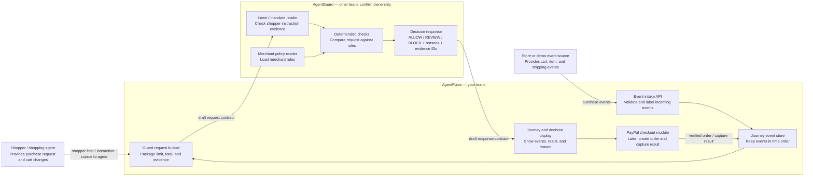

# AgentPulse and AgentGuard Team Handoff

> **This is an older discussion draft.** The current approved merchant-facing flow, API proposal, team split, and sequence diagrams are in [AgentPulse_Merchant_Integration_Design.md](AgentPulse_Merchant_Integration_Design.md). Use that document as the current direction and update this handoff after AgentGuard confirms the request and response contract.

This is a discussion template for the two teams. The ownership and JSON examples below are proposals based on the current project flow. Confirm them together before treating them as the agreed design.

## Plain-language summary

- **AgentPulse** keeps the purchase story: it receives events and shows what happened, in order.
- **AgentGuard** checks whether the purchase follows the shopper’s instructions and the merchant’s rules. It returns `ALLOW`, `REVIEW`, or `BLOCK`.
- **Together**, the two parts let a merchant see the purchase events, the decision, and the reason for that decision.

## Module ownership and flow

The diagram below is a proposed split. The AgentGuard team should confirm its modules and the point where its code accepts the request. Arrows show the order in which data moves.



### Flow in plain words

1. A store or demo source sends purchase events to **AgentPulse**. The shopper or shopping agent supplies the purchase limit or instruction; the teams still need to agree who provides that information and in what format.
2. AgentPulse checks that each event has the basic fields, stores it, and builds the purchase timeline.
3. AgentPulse packages the latest total and relevant event IDs into a request for **AgentGuard**.
4. AgentGuard reads the shopper instruction and merchant rules, runs its checks, and sends back a decision with a reason and the event IDs it used.
5. AgentPulse shows the decision beside the timeline. Later, AgentPulse adds PayPal checkout and records PayPal's verified result as another event.

PayPal is a later checkout integration. It supplies order and payment results; it does not supply the shopper's intent or the merchant policy in this proposed design.

## Proposed ownership

| Work area | Proposed owner | Work |
|---|---|---|
| Purchase events and timeline | AgentPulse team | Receive events, check required fields, store them, sort by time, and show the journey. |
| Shopper intent or mandate evidence | AgentGuard team, confirm | Decide what evidence is needed and how it is represented. Confirm who supplies it: shopper/agent flow, another team, or demo data. |
| Merchant rules | AgentGuard team, confirm | Define the rules and how the merchant sets or provides them. |
| Decision | AgentGuard team | Check the purchase and return `ALLOW`, `REVIEW`, or `BLOCK`, with reasons and supporting event IDs. |
| Display decision with purchase history | AgentPulse team | Show AgentGuard’s answer beside the relevant timeline events. |
| PayPal checkout and payment result | AgentPulse team, confirm | Later, create/capture a Sandbox order on the backend and add PayPal’s verified result to the journey. |
| Shared connection | Both | Agree on request/response fields, connection method, sample cases, and failure behavior. |

## Questions for the AgentGuard team

Please answer these together so both teams can build against the same expectations.

1. What exactly are you building: Java code we can call, a separate web service with a URL, or a demo result for now?
2. What information do you need from AgentPulse to check a purchase? Please share one example request.
3. Where does the shopper’s spending limit or purchase instruction come from? Which team supplies it?
4. Where do merchant rules come from? Which team sets or supplies them?
5. What answer will AgentGuard return? Can it include `ALLOW`, `REVIEW`, or `BLOCK`, a short reason, and the event IDs it used?
6. What should AgentGuard return when an instruction, rule, or event is missing or unclear?
7. How should we connect during the hackathon: call a Java method, call a web address, or exchange agreed sample JSON?
8. Can we agree on one within-limit example and one over-limit example, with the expected answer for each?
9. Who will own the shared request/response definition and tell both teams when it changes?

## Draft request and response

These are examples for discussion only. They are not an agreed API contract. AgentGuard should confirm, change, or replace the fields.

### AgentPulse sends to AgentGuard

```json
{
  "journeyId": "demo-shoes-001",
  "shopperLimit": {
    "amount": 200.00,
    "currency": "USD",
    "source": "simulated_demo"
  },
  "latestTotal": {
    "amount": 209.00,
    "currency": "USD"
  },
  "events": [
    {
      "eventId": "evt_101",
      "type": "cart_created",
      "amount": 179.00,
      "source": "simulated_demo"
    },
    {
      "eventId": "evt_102",
      "type": "shipping_updated",
      "amount": 209.00,
      "source": "simulated_demo"
    }
  ]
}
```

### AgentGuard sends back to AgentPulse

```json
{
  "decision": "BLOCK",
  "reasonCode": "OVER_SHOPPER_LIMIT",
  "message": "The latest total is above the shopper's $200 limit.",
  "evidenceEventIds": ["evt_102"],
  "missingInformation": []
}
```

## Proposed rules for the connection

- AgentGuard makes the decision; AgentPulse displays it. AgentPulse should not quietly change `BLOCK` into `ALLOW`.
- The decision should point to the event IDs it used so the merchant can see the evidence.
- If required information is missing, AgentGuard should say what is missing. The teams should agree whether that means `REVIEW` or another response.
- Mark demo events as `simulated_demo`. Do not describe simulated events as real signed mandates or real store records.
- PayPal supplies order and payment results after its API calls. PayPal does not supply the shopper’s intent or your merchant policy for this design.

## Current AgentPulse project status

Already present: Spring Boot backend, temporary in-memory event storage, a journey timeline endpoint, event intake endpoint, and a demo story with totals of $179 and $209.

Not connected yet: AgentGuard, a real store/shopping agent, persistent database, PayPal Sandbox, or AI explanation service. Demo events disappear when the app restarts.

## Decisions to record after the meeting

- AgentGuard connection type: `[Java method / web service / demo JSON / other]`
- AgentGuard request example approved: `[yes/no; link or owner]`
- AgentGuard response example approved: `[yes/no; link or owner]`
- Shopper intent supplied by: `[team/service]`
- Merchant rules supplied by: `[team/service]`
- Missing evidence behavior: `[decision/result]`
- AgentPulse owner: `[name]`
- AgentGuard owner: `[name]`
- Shared contract owner: `[name]`
- Next integration check-in: `[date/time]`
