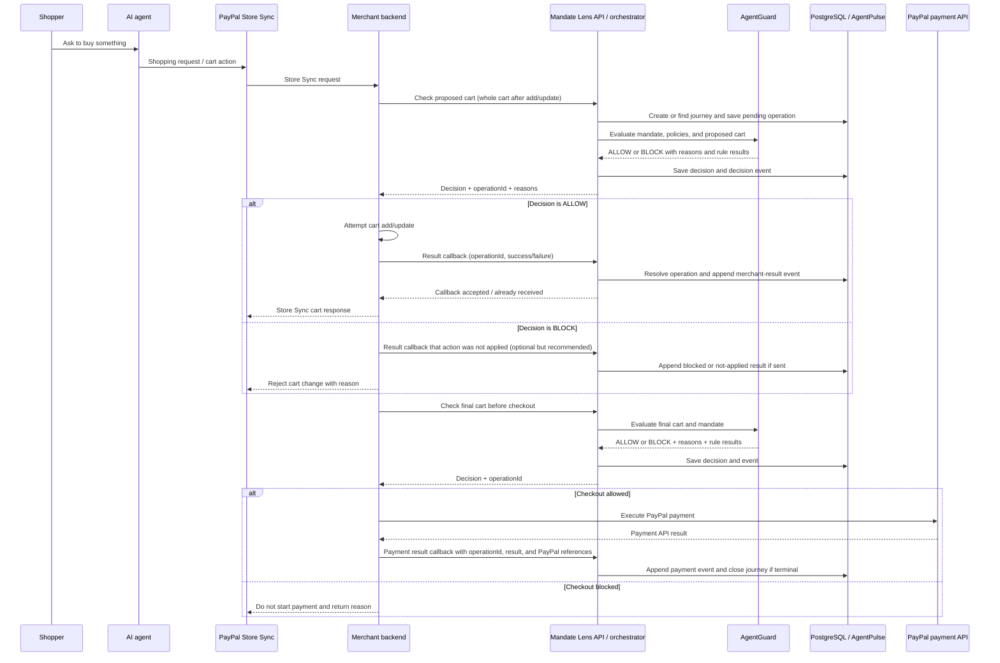
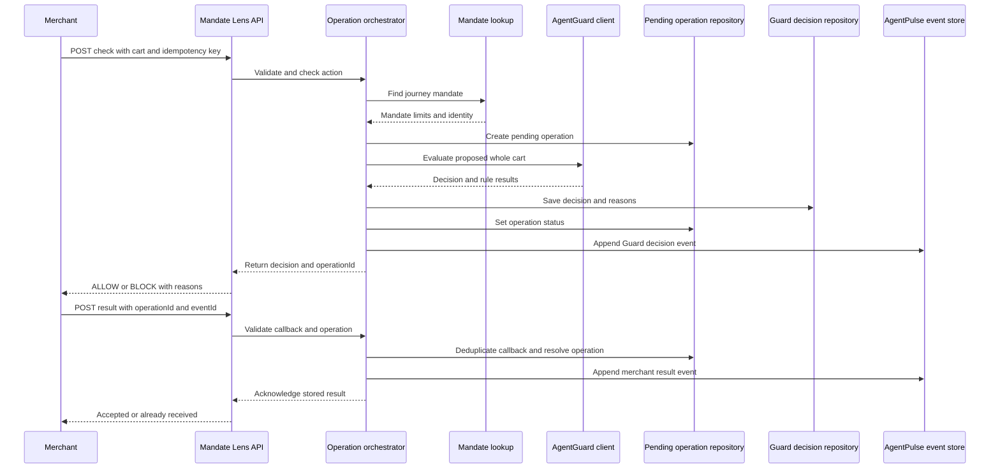

# AgentPulse and Merchant Integration Design

**Status:** Approved direction for detailed design
**Scope:** Hackathon demo using a merchant backend, PayPal Store Sync, AgentGuard, AgentPulse, and PayPal Sandbox.

## 1. Plain-language summary

The merchant owns and changes the shopping cart. Before it adds or changes an item, it asks Mandate Lens whether the proposed cart is allowed. Mandate Lens asks AgentGuard to apply the shopper's mandate and merchant rules. Mandate Lens returns `ALLOW` or `BLOCK` with reasons and an `operationId`.

If allowed, the merchant tries the cart change and sends a result callback to Mandate Lens. Mandate Lens records both the Guard decision and the merchant's actual result in the AgentPulse journey. Before payment, the merchant checks the final cart again. The merchant then uses PayPal for payment and reports the final payment result to Mandate Lens.

Mandate Lens is not a replacement cart or payment processor. It is the place that coordinates the decision and keeps the auditable purchase story.

## 2. Ownership

| Owner | Owns / does |
|---|---|
| PayPal Store Sync | Routes the shopper's AI shopping activity to the merchant's Store Sync integration. |
| Merchant team | Store Sync API implementation, catalog, cart, inventory, order, PayPal execution, and authoritative success/failure results. |
| AgentGuard teammate | Reads mandate and merchant policy inputs, evaluates proposed actions, and returns `ALLOW` or `BLOCK` with rule results and reasons. |
| AgentPulse (your work) | Merchant-facing check/result API, operation tracking, journey timeline, event persistence, timeouts, deduplication, and showing what happened. |
| PayPal | Payment processing and payment status through the merchant's PayPal integration. |

For the hackathon, these can be modules in one Spring Boot app. Keep package boundaries clear so the teams can work separately without needing separately deployed services.

## 3. End-to-end flow



### Mandate Lens internal flow

This view zooms into Mandate Lens. The merchant makes one check request; the orchestrator coordinates the Guard check and records the decision. The later result callback closes the pending operation and adds the merchant's actual outcome to the journey.



### Important timing

- `ALLOW` means the merchant may attempt the requested action. It does not claim the cart was successfully changed.
- AgentPulse records the Guard result immediately. It does not wait for the callback to learn the decision.
- The callback tells AgentPulse what happened afterward. This lets the timeline show both “Guard allowed it” and “merchant could not add it,” for example.
- For a `BLOCK`, the merchant must not apply the change. It should return the rejection to Store Sync. A callback saying `NOT_APPLIED` is recommended so the operation is closed and the journey is complete, but Mandate Lens already knows the Guard blocked it.
- Payment checking and payment execution are different. Mandate Lens returns a decision; the merchant calls PayPal and reports the payment result.

## 4. Cart decision rule

Check additions and updates, including the first item. Send AgentGuard the **whole proposed cart after the change**, rather than only the new line. For the first item, current cart is empty and proposed cart contains the item.

Example: current cart is $80 and the shopper adds a $50 product. AgentGuard evaluates the proposed $130 cart against the mandate and merchant rules. This avoids checking only the new $50 against a $100 budget while ignoring the $80 already present.

Removals do not need a Guard check under the approved scope. The merchant should still send a result callback for a removal so the journey timeline reflects the actual cart. It can generate an operation ID for the removal; Mandate Lens creates a result-only operation when it receives that callback. Removal events do not create new spending, but the post-removal cart should be used for the next add/update/checkout check.

## 5. Proposed API contract

The endpoints and JSON below are a proposal for implementation. Before coding the integration, the merchant and AgentGuard owners should confirm field names and whether their Store Sync payload contains equivalent data.

### 5.1 Check an action

`POST /api/v1/merchant-operations/check`

```json
{
  "merchantId": "STRIDEHUB",
  "journeyId": "journey-123",
  "cartId": "cart-456",
  "action": "ADD_ITEM",
  "idempotencyKey": "merchant-demo:cart-456:add:request-789",
  "currentCart": {
    "currency": "USD",
    "items": [
      { "productId": "shoe-1", "category": "RUNNING_SHOES", "quantity": 1, "unitPrice": 80.00 }
    ],
    "total": 80.00
  },
  "proposedCart": {
    "currency": "USD",
    "items": [
      { "productId": "shoe-1", "category": "RUNNING_SHOES", "quantity": 1, "unitPrice": 80.00 },
      { "productId": "sock-2", "category": "ACCESSORIES", "quantity": 1, "unitPrice": 50.00 }
    ],
    "total": 130.00
  },
  "shippingCountry": "US"
}
```

Mandate Lens validates the request, finds the journey's mandate, creates a pending operation, calls AgentGuard, stores the complete decision, appends a decision event, and returns:

```json
{
  "operationId": "op-890",
  "journeyId": "journey-123",
  "decisionId": "decision-891",
  "decision": "ALLOW",
  "reasons": [],
  "ruleResults": [
    { "ruleId": "budget", "result": "PASS", "message": "Proposed total is within the authorized amount." },
    { "ruleId": "category", "result": "PASS", "message": "All items are in an allowed category." }
  ],
  "operationStatus": "AWAITING_MERCHANT_RESULT"
}
```

For `BLOCK`, return the same shape with `decision: "BLOCK"`, reasons and failed rule results. The merchant must not apply the change. The project uses only `ALLOW` and `BLOCK` for this version. If AgentGuard returns `REVIEW`, Mandate Lens maps it to `BLOCK` for the merchant and retains the original Guard outcome in the stored decision context.

### 5.2 Report what happened

Use one shared endpoint for cart results, removals, checkout results, and payment results:

`POST /api/v1/merchant-operations/{operationId}/result`

Successful cart update:

```json
{
  "eventId": "merchant-demo:event-900",
  "merchantId": "STRIDEHUB",
  "journeyId": "journey-123",
  "cartId": "cart-456",
  "eventType": "CART_UPDATE_SUCCEEDED",
  "outcome": "SUCCESS",
  "occurredAt": "2026-10-24T10:15:30Z",
  "merchantReference": "cart-revision-4",
  "details": { "itemCount": 2, "total": 130.00, "currency": "USD" }
}
```

Failed cart update uses `CART_UPDATE_FAILED` / `FAILED` and a safe failure code/message. Removal can use `ITEM_REMOVAL_SUCCEEDED` or `ITEM_REMOVAL_FAILED`; because removals skip Guard, the merchant creates an operation ID and uses this same result endpoint. Mandate Lens records a result-only operation for it.

For a payment decision, the merchant first asks the check endpoint using action `CHECKOUT`. Once it executes payment through PayPal, it posts `PAYMENT_SUCCEEDED` or `PAYMENT_FAILED` against that checkout `operationId`, including PayPal order/capture references where available. Never include card credentials or secrets.

Mandate Lens responds with `200 OK` when newly stored and `200 OK` with `alreadyReceived: true` when the same event is retried. Reusing an event ID with different contents returns `409 Conflict` so a changed result is not silently accepted.

### 5.3 Read the full journey for a merchant

This is a strong next AgentPulse feature. A merchant needs more than a payment or cart error code: it needs the checks, Guard reasons, and the actual merchant result in order, so it can explain the failure to the AI agent or shopper.

Use the `journeyId` as the main lookup key because it identifies the full shopping attempt across cart changes, checks, callbacks, and checkout. The merchant already sends this ID in the check request and receives it in the response. Keep the cart ID in the returned data so the merchant can confirm that the journey is for the expected cart.

Endpoint:

`GET /api/v1/journeys/{journeyId}?merchantId={merchantId}`

This is the richer, versioned merchant API. The existing `GET /api/journeys/{journeyId}` only returns the event list and is the earlier demo endpoint. The new response aggregates the journey row, pending operation history, stored AgentGuard decisions/reasons, and ordered AgentPulse events. In the local demo, `merchantId` is required and the query only returns a journey whose saved merchant ID matches. That is an ownership check for the demo, not authentication. Before exposing this API outside localhost, replace it with identity taken from authenticated merchant credentials.

Example response:

```json
{
  "journeyId": "journey-123",
  "merchantId": "STRIDEHUB",
  "cartId": "cart-456",
  "status": "ACTIVE",
  "latestEventType": "CART_UPDATE_FAILED",
  "latestOutcome": "FAILED",
  "startedAt": "2026-10-24T10:14:00Z",
  "lastEventAt": "2026-10-24T10:15:30Z",
  "endedAt": null,
  "operations": [
    { "operationId": "op-890", "cartId": "cart-456", "action": "ADD_ITEM", "status": "FAILED", "decisionId": "decision-891", "resultEventId": "event-900", "createdAt": "2026-10-24T10:15:00Z", "resolvedAt": "2026-10-24T10:15:30Z" }
  ],
  "decisions": [
    { "decisionId": "decision-891", "operationId": "op-890", "action": "ADD_ITEM", "decision": "ALLOW", "reasons": [], "ruleResults": [{ "ruleId": "budget", "result": "PASS", "message": "Proposed total is within the authorized amount." }], "evaluatedAt": "2026-10-24T10:15:00Z" }
  ],
  "timeline": [
    { "eventId": "evt-guard-op-890", "type": "CART_ACTION_CHECKED", "source": "AGENT_GUARD", "outcome": "INFO", "correlationId": null, "details": { "message": "Guard check recorded" }, "occurredAt": "2026-10-24T10:15:00Z" },
    { "eventId": "event-900", "type": "CART_UPDATE_FAILED", "source": "MERCHANT", "outcome": "FAILED", "correlationId": null, "details": { "message": "Inventory was unavailable" }, "occurredAt": "2026-10-24T10:15:30Z" }
  ]
}
```

**Important:** AgentPulse should return recorded Guard and merchant facts. The AI agent can turn those facts into a shopper-friendly explanation, but should not change an `ALLOW`/`BLOCK` result or invent a reason. For the MVP, `explanation.summary` can be assembled from known event types and stored reason messages; do not add a new AI call inside AgentPulse.

In a deployed environment, require merchant authentication and check that the authenticated merchant owns the journey. Do not rely only on a caller-supplied `merchantId` path or query field. Return only safe, relevant fields: event time/type, decision, rule result, reason code/message, amounts when needed, operation/cart references, and outcome. Do not return raw mandate evidence, credentials, or unnecessary shopper personal details.

The code has the basic `GET /api/journeys/{journeyId}` timeline endpoint, which only reads `journey_events`. The richer read-only endpoint is implemented through `MerchantJourneyController`, `JourneyQueryService`, and `JourneyReadRepository`. It combines `trust.trust_journeys`, `trust.pending_operations`, `trust.guard_decisions`, and `trust.journey_events`. It does not call AgentGuard or PayPal again.

### 5.4 Operation IDs and duplicate protection

- Mandate Lens creates and returns the `operationId` for every check.
- Merchant sends that ID back with the result callback.
- Merchant supplies a stable `eventId`; retrying the same callback must reuse it.
- The check request includes an `idempotencyKey`; retrying a check with the same key returns the original operation/decision rather than creating a second decision.
- A result is accepted once. An identical retry is acknowledged; a conflicting second result is rejected and requires investigation.

## 6. Operation and journey states

```text
Operation:
PENDING_CHECK → AWAITING_MERCHANT_RESULT → SUCCEEDED / FAILED / NOT_APPLIED
                                      └→ TIMED_OUT (no callback before deadline)

Journey:
ACTIVE → COMPLETED (payment succeeded)
       → EMPTY (cart has no items; may remain resumable until expiry)
       → EXPIRED (inactivity deadline passed)
       → FAILED (terminal payment failure, only if team chooses this policy)
```

Recommended behavior:

- A failed add/update does not end the journey; the shopper may try another action.
- A payment failure should be recorded but should not necessarily end the journey. The merchant may allow another payment attempt. Close it only on payment success or expiry unless the merchant confirms it is terminal.
- When all items are removed, mark the journey empty but retain it for a configurable grace period. If the shopper adds an item again to the same cart/journey, resume it; otherwise expire it.
- Use an inactivity timeout, refreshed by a new meaningful event. Pick a demo value (for example, 30 minutes) as configuration rather than hardcoding the business rule. The exact duration remains to be agreed.
- A pending operation timeout means “merchant result not received.” It must not be falsely shown as a confirmed cart failure.

## 7. AgentPulse event timeline

Minimum events for the demo:

| Event | Created when | Source |
|---|---|---|
| `CART_ACTION_CHECKED` | Guard returns an outcome for an add/update or checkout | AgentGuard / Mandate Lens |
| `CART_UPDATE_SUCCEEDED` | Merchant confirms an add/update succeeded | Merchant |
| `CART_UPDATE_FAILED` | Merchant confirms an add/update failed | Merchant |
| `ITEM_REMOVAL_SUCCEEDED` / `ITEM_REMOVAL_FAILED` | Merchant reports a removal result | Merchant |
| `OPERATION_TIMED_OUT` | Result callback was not received before deadline | Mandate Lens |
| `PAYMENT_SUCCEEDED` / `PAYMENT_FAILED` | Merchant reports PayPal result | Merchant (based on PayPal response/webhook) |
| `JOURNEY_EXPIRED` | Expiry job closes an inactive journey | Mandate Lens |

The Guard decision event should retain `decisionId`, operation ID, decision, action, rule results, reason codes/messages, and a safe snapshot/reference of the proposed cart. This allows the timeline to show the checks AgentGuard performed, not just the final ALLOW/BLOCK label.

## 8. PostgreSQL storage plan

The current migration already has `trust.trust_journeys`, `trust.guard_decisions`, and append-only `trust.journey_events`. It also has merchant cart/order/payment tables for the local simulator. Build on these rather than storing the same cart as a second authoritative copy inside AgentPulse.

Add a `trust.pending_operations` table (name provisional) with at least:

- `operation_id` primary key;
- `journey_id`, `merchant_id`, `cart_id`;
- `action_type`, `status`, `idempotency_key`;
- `guard_decision_id` after evaluation;
- request context / proposed cart snapshot needed to explain the decision;
- `created_at`, `result_due_at`, `resolved_at`;
- unique merchant + idempotency key constraint.

Use `trust.journey_events.event_id` as the callback deduplication key. Keep merchant payment references and safe statuses only. Do not store payment credentials. Limit access/retention for personal details such as addresses and email; AgentPulse needs only what is necessary to evaluate and explain the decision.

## 9. Spring Boot module boundaries

The application request entry point is `MerchantOperationController`. It receives the merchant's check or result request and hands it to `MerchantOperationService`. That service coordinates shared mandate lookup, AgentGuard evaluation, pending-operation state, and AgentPulse timeline writes. `AgentGuardClient` is the boundary between the AgentPulse flow and the separate AgentGuard policy service. It is an adapter and contract inside Mandate Lens; the policy engine remains owned by the other teammate.

The PlantUML class diagram is available at [docs/mandatelens_class_diagram.puml](docs/mandatelens_class_diagram.puml). Read it from the merchant side: `MerchantOperationController` → `MerchantOperationService` → `MandateService` and `AgentGuardClient`; then the decision is saved through `GuardDecisionRecorder`, `PendingOperationRepository`, and `EventStore`. The later merchant result callback returns through the same controller and service, resolves the operation, and adds another event to the journey. For journey reading, `MerchantJourneyController` → `JourneyQueryService` → `JourneyReadRepository` loads and combines the saved facts.

The journey-read request sequence is in [docs/mandatelens_journey_read_sequence.puml](docs/mandatelens_journey_read_sequence.puml). It shows the merchant asking for the journey after a failed action, Mandate Lens assembling a safe explanation from stored facts, and the merchant passing that explanation to the AI agent.

```text
com.emeralds.mandatelens
  merchant/                         # merchant owns actual cart/order APIs and state
  mandate/                          # find verified/demo mandate for journey
  agentguard/client/                 # shared AgentGuard interface + HTTP adapter
  agentguard/model/                  # request/reply contract with Guard team
  agentpulse/api/                    # merchant-facing check and result endpoints
  agentpulse/orchestration/          # coordinate operation, Guard call, and event write
  agentpulse/operation/              # pending-operation model, state rules, repository
  agentpulse/event/                  # append-only journey events and timeline query
```

The orchestrator order for a check is: validate identifiers and cart → resolve journey/mandate → create or retrieve idempotent pending operation → call AgentGuard → save decision and rules → append decision event → return response. On callback: validate operation and event ID → enforce allowed state transition → save the result once → append event → update journey status if terminal → acknowledge quickly.

Do not hold a database transaction open while waiting on AgentGuard or PayPal. Use short transactions around the pending operation and decision/event writes. If Mandate Lens crashes after Guard responds but before persistence, an idempotency key lets the retry recover without confusing the merchant.

## 10. Async callback and security

The callback is asynchronous from the merchant's point of view: it sends the result after completing its own operation and does not need to wait for a user-facing timeline page. Mandate Lens should validate the merchant identity, store the event, and return an acknowledgment. In the initial Spring Boot demo, writing to PostgreSQL is enough; a message broker is not required. If a separate Pulse process is introduced later, an outbox/queue can deliver stored events reliably.

Before exposing endpoints beyond local demo, agree how the merchant authenticates (for example, OAuth client credentials or signed requests), authorize each merchant to its own journey/cart IDs, use TLS, and prevent replay of callbacks. Do not expose the current loopback-only simulator as a public endpoint.

## 11. Failure behavior

- AgentGuard unreachable, malformed, or missing required rule results: fail closed; do not authorize the merchant action.
- `BLOCK`: merchant does not apply the add/update or start checkout.
- Merchant cart update fails after `ALLOW`: callback says failed; decision remains ALLOW, outcome is FAILED.
- Callback delivery fails: merchant retries with same operation/event IDs; Mandate Lens deduplicates.
- Duplicate identical callback: acknowledge as already received.
- Conflicting callback for a resolved operation: reject with conflict and preserve existing audit history.
- PayPal reports payment failure: record failure; allow merchant's retry policy to decide if another checkout attempt can start.
- No result callback: mark operation timed out; do not infer success or failure.

## 12. Build order and team split

### AgentGuard teammate

1. Confirm exact mandate fields and rule inputs (budget, currency, categories, merchant policy, shipping country, cart total).
2. Confirm the contract for evaluating the **whole proposed cart** and checkout.
3. Return `ALLOW` or `BLOCK`, decision ID, reasons, and per-rule results.
4. Define what happens for missing/invalid mandate data; recommended behavior is `BLOCK` with a clear reason.
5. Provide endpoint or Java interface, sample requests/responses, and one allowed plus one blocked example.

### AgentPulse (your work)

1. Agree the merchant-facing check and shared result callback schemas.
2. Add operation persistence and idempotency handling.
3. Build the orchestrator that calls the AgentGuard interface and stores decision + event.
4. Add callback validation, deduplication, state changes, and journey timeline entries.
5. Add operation timeout and journey expiry configuration/job.
6. Add APIs to read a journey and its linked decisions/operation statuses for the demo.

### Merchant/Store Sync integration

1. Send checks before first add, every add/update, and checkout.
2. Apply cart changes only after `ALLOW`; do not call PayPal for a blocked checkout.
3. Send result callbacks after cart operations and payment attempts, with stable IDs.
4. Retry callbacks on network failure and preserve the same IDs.
5. Keep cart/order state authoritative in the merchant system.

## 13. Remaining contract decisions

These are small enough to settle during API review, but should be explicit before implementation:

1. Confirm final names and required fields for the check and callback JSON.
2. Decide how removals get an operation ID if they skip Guard: recommended `POST /operations` or permit a result event with a merchant-generated operation ID.
3. Pick demo inactivity and pending-result timeouts (configuration, not hardcoded logic).
4. Agree whether payment failure leaves the journey active for retry (recommended) and which PayPal signal is authoritative (merchant API response, verified PayPal webhook, or both).
5. Agree how merchant authentication and mandate evidence are supplied. For the demo, use an explicitly simulated mandate and a trusted local merchant identity.
6. Decide whether callback details include a minimal cart snapshot or only references/totals. Prefer references and totals unless AgentPulse needs line details to explain a rule.

## 14. Code changes made to follow this design

The backend now has a merchant-facing API separate from the local Store Sync simulator:

- `POST /api/v1/merchant-operations/check` checks `ADD_ITEM`, `UPDATE_CART`, or `CHECKOUT` against the whole proposed cart and returns an `operationId`, `decisionId`, `ALLOW`/`BLOCK`, reasons, and rule results.
- `POST /api/v1/merchant-operations/{operationId}/result` accepts cart, removal, and payment outcomes. Stable event IDs make matching retries safe; reuse with different callback content is rejected.
- PostgreSQL migration V2 adds pending-operation and callback-deduplication storage. Decision and callback events are written to the AgentPulse journey timeline.
- Pending result callbacks time out after a configurable period. Journeys expire after configurable inactivity. Successful payment closes the journey; an emptied cart is kept as `EMPTY` until activity resumes or it expires.
- Default settings are 300 seconds for a callback and 1800 seconds for journey inactivity. Change them with `mandatelens.operation.callback-timeout-seconds` and `mandatelens.journey.inactivity-timeout-seconds`.

The current demo mandate is seeded for journey `demo-shoes-001` and merchant `STRIDEHUB`. The new API checks that the request merchant matches that mandate. AgentGuard must be configured at `agentguard.base-url`; the current HTTP adapter permits loopback only until authentication is agreed. This is a local integration boundary, not public production security.

## 15. Current code versus planned design

Already in the repository: Spring Boot feature packages; PostgreSQL journey, decision, merchant cart/order/payment tables; an AgentGuard HTTP client contract; a local Store Sync simulator; PayPal Orders client; a timeline event store. The new merchant-facing check/result APIs and pending operation storage are now implemented. The simulator still has its older direct orchestration path and has not been rewired to call these new APIs.

Still to build for a complete team demo: wire the merchant Store Sync adapter to the check/result APIs; replace the demo merchantId journey ownership check with authenticated identity before exposing the read endpoint beyond localhost; have the AgentGuard service return meaningful rule results; connect real shopper/agent mandate evidence; and agree the final request/response contract with the merchant and AgentGuard teammate. Configure and try the callback and journey timeouts with realistic demo behavior.

The local simulator currently has different ownership from the target design because its merchant cart and Mandate Lens code run in the same backend. Treat it as demo scaffolding; the merchant-facing Mandate Lens API is the boundary the real merchant Store Sync adapter should call.

## References

- PayPal Store Sync overview: https://developer.paypal.com/agentic-commerce-services/about#store-sync
- Current implementation notes: [mandatelens_flow_diagram.md](mandatelens_flow_diagram.md)
- Current database schema: [src/server/src/main/resources/db/migration/V1__initial_schema.sql](src/server/src/main/resources/db/migration/V1__initial_schema.sql)
- Current AgentGuard handoff (older proposal; update it after API contract agreement): [AgentPulse_AgentGuard_Handoff.md](AgentPulse_AgentGuard_Handoff.md)
