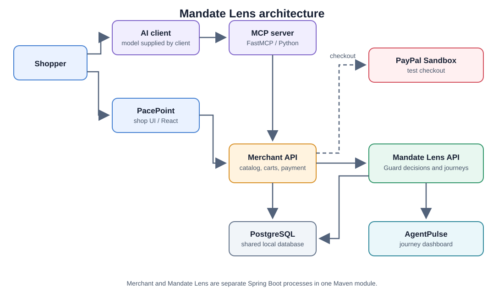

# Mandate Lens

Mandate Lens is a demo commerce system for checking agent-driven shopping actions against a shopper's budget, recording Guard decisions, and showing the resulting journey. **PacePoint** is the customer-facing shop brand. `STRIDEHUB` is its demo merchant ID used by APIs and saved journey records.

## Demo video

[Watch the Mandate Lens demo on YouTube](https://www.youtube.com/watch?v=bkY0ZYk8xfY).

## Project layout

Mandate Lens demonstrates a safer agent-assisted shopping journey. A shopper asks an AI assistant to find products and provides a budget. The PacePoint shop presents the proposed items and requires the shopper to approve the selection. Merchant then sends the cart to Mandate Lens, where the deterministic demo Guard checks the budget and cart before checkout. The AgentPulse dashboard shows the recorded journey, decisions, and events. The documented end-to-end purchase uses PayPal Sandbox checkout. The demo makes the approval steps visible and keeps the shopper in control; it is not a production payment or authorization system.

## Demo video

**YouTube:** `[add the public demo video URL here]`

## Hosted demo

- [PacePoint storefront](https://mandate-lens-store.onrender.com)
- [AgentPulse dashboard](https://mandate-lens-agentpulse.onrender.com)
- MCP endpoint: `https://mandate-lens-mcp.onrender.com/mcp`

See the [run and end-to-end guide](docs/end-to-end-shopping-flow.md) for MCP connection steps and the complete hosted purchase procedure.

## Tools and AI

### Application stack

  
  
  
  
  
  
  
  

### Deployment and API testing

  
  

[Spring Boot](https://spring.io/projects/spring-boot) and Java run the APIs. React and Vite power the PacePoint store and AgentPulse dashboard. [FastMCP](https://gofastmcp.com) and Python provide the MCP server, and PostgreSQL stores the demo data. [Render](https://render.com) hosts the APIs, MCP server, and web interfaces. [Postman](https://www.postman.com/) is used to send requests to and inspect the APIs during development. The end-to-end purchase uses PayPal Sandbox checkout.

The MCP server exposes the PacePoint shop to a compatible AI client. In the demo, the AI client interprets the shopping request, opens the shop, and can retrieve a saved journey summary. The shopper uses the shop UI to approve product selection, cart changes, the final Guard review, and payment. The connected client supplies the model; the repository does not bundle one. The repo includes a Cursor MCP configuration in `.cursor/mcp.json`, but it does not record the Cursor app version or the model selected during a demo.

Record the exact client and model used in the submitted demo here:

- MCP client: `Cursor`
- Model or AI service: `Composer 2.5` (Cursor Free plan; [Cursor model availability](https://cursor.com/docs/models-and-pricing))
- How it was used: Interpreted the shopping request, opened the PacePoint shop, and retrieved a saved journey summary. The shopper approved selection, Guard review, and payment in the UI.

## Repository map

| Path | Purpose | Local address |
| --- | --- | --- |
| `src/server/` | Spring Boot APIs for Mandate Lens and Merchant; separate processes built from one Maven module | Mandate Lens `:8081`, Merchant `:8080` |
| `merchant-ui/` | PacePoint shopper-facing store | `http://localhost:5173` |
| `agentpulse-ui/` | AgentPulse journey and decision dashboard | `http://localhost:5174` |
| `mcp-server/` | FastMCP shop used by compatible AI clients | `http://127.0.0.1:8001/mcp` |
| `docs/` | Maintained run procedure and architecture documentation | — |
| `admin-docs/` | Local reference archive; ignored by Git | — |

The merchant service owns the product catalog, cart, and payment adapter. Mandate Lens owns mandates, Guard orchestration, decisions, events, and journey reads. The UIs and MCP server call these APIs; the shop does not own payment credentials or cart pricing.

## Run locally

For the complete procedure from a clean clone—including prerequisites, database setup, environment configuration, commands to start each app, and the end-to-end purchase—follow the [run and shopping flow guide](docs/end-to-end-shopping-flow.md). It also explains how to use the hosted services if you don’t want to run the project locally.

For service responsibilities and request flow, see the [architecture overview](docs/architecture.md). The [documentation index](docs/README.md) links to the maintained guides. Render environment settings are in [mcp-server/README.md](mcp-server/README.md#paypal-sandbox-from-the-mcp-shop).

This repository is licensed under the [MIT License](LICENSE). Before submitting, confirm the repository is public, replace the attribution placeholders above with the exact client and model used, and provide judges with either a hosted demo or the [run instructions](docs/end-to-end-shopping-flow.md). Include a demo video URL in the submission form if one is required.

## Demo boundaries

- The shopper's budget is a simulated constraint, not a signed or verified AP2 authorization.
- `agentguard-deterministic` is a local demo policy profile; it is not a production authorization service.
- The documented checkout uses PayPal Sandbox test accounts; it does not move real money.
- The first service split still uses one Maven module and one shared local PostgreSQL database. See the [architecture overview](docs/architecture.md) for service ownership and data flow.
