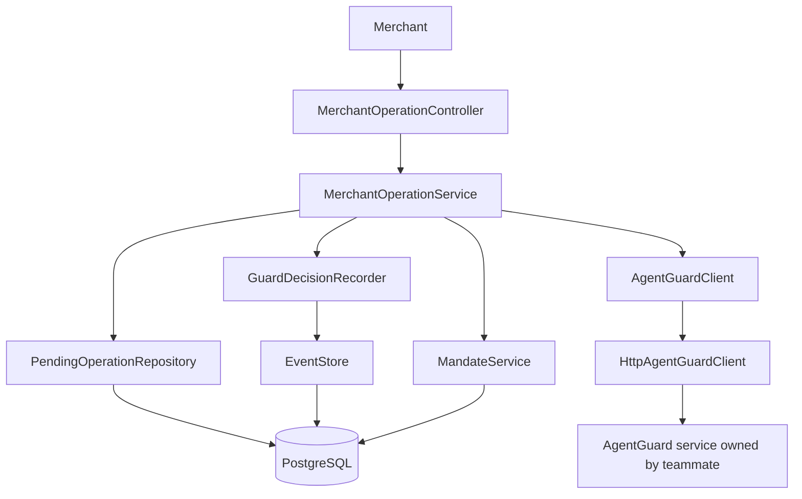

# Mandate Lens

Mandate Lens is the Spring Boot service under `src/server`. It exposes a merchant-facing operation check/result API that calls the configured AgentGuard service and records decisions and merchant outcomes in PostgreSQL. The local Store Sync simulator uses that same orchestration for cart creation, cart updates, removals, and checkout. The optional React storefront lives under `storefront` and is for presentations only.

## Project layout

- `src/server/` — Spring Boot / Java 17 API and service modules.
- `storefront/` — optional React shop used for presentations; it is not a Mandate Lens service.
- `docs/mandatelens_design.md` — current as-built hackathon architecture and flow overview.
- `docs/database-schemas.md` — all PostgreSQL schemas, tables, columns, keys, and migrations.
- `docs/api-contracts.md` — Mandate Lens, Store Sync simulator, AgentGuard, and simulated mandate contracts.
- `docs/mandatelens_class_diagram.puml` — PlantUML source for the core operation and journey-read flow.
- `AgentPulse_Hackathon_Starter_Guide.docx` — project and demo guide.

Source layout:

```text
src/
  server/src/main/java/com/emeralds/mandatelens/
    MandateLensApplication.java       # starts the one backend application
    agentpulse/                       # entry APIs, orchestration, events, operations
    agentguard/                       # separate Guard client and contract models
    mandate/                          # shared trust data used by both modules
    merchant/                         # catalog, cart, Store Sync, PayPal adapter
  server/src/main/resources/          # Spring config and database migrations
storefront/                            # optional shopper-facing UI, outside the services
```

The `src/` directory contains the Spring Boot application. AgentPulse owns the merchant operation API, pending operations, and journey history. The AgentGuard area contains the HTTP contract adapter plus local deterministic and sandbox-test implementations; the separately deployed policy engine is outside this application. `storefront/` is an optional sample shop for presentations; it is not part of the service architecture.



The current hackathon overview is in [docs/mandatelens_design.md](docs/mandatelens_design.md). See [docs/database-schemas.md](docs/database-schemas.md) for the full PostgreSQL schema reference and [docs/api-contracts.md](docs/api-contracts.md) for the mandate and HTTP contracts. The PlantUML diagram covers the core operation and journey-read paths; the AP2 intake and Store Sync simulator flow are detailed in the design document.

For local end-to-end checks, including the merchant operation API and optional PayPal Sandbox checkout, see [docs/local-e2e.md](docs/local-e2e.md).


## Run the backend

Use Java 17+, PostgreSQL, and the included Maven wrapper. Create a database named `mandatelens`; Flyway creates the `merchant` and `trust` schemas and tables from migrations under `src/server/src/main/resources/db/migration`. The bundled product CSV seeds an empty catalog once; PostgreSQL is the catalog source after seeding. Store Sync adapter fields not represented in the schema are kept in `merchant.store_sync_cart_state`.

Set `DATABASE_URL`, `DATABASE_USERNAME`, and `DATABASE_PASSWORD` for your PostgreSQL instance. Defaults connect to `jdbc:postgresql://localhost:5432/mandatelens` as `postgres` with password `postgres`.

From the project root in PowerShell:

```powershell
.\mvnw.cmd -pl src/server spring-boot:run
```

On macOS/Linux, run `make run-server` from the project root. It sources `local-env.sh` and starts the backend with the Maven wrapper. In a second terminal, run `make run-storefront` to start the shop; it installs locked npm dependencies if needed and points the storefront at `http://localhost:8080`.

The API runs at `http://localhost:8080`.

## Run the shop frontend

Open a second terminal:

```powershell
cd storefront
npm install
$env:VITE_API_URL = "http://localhost:8080"
npm run dev
```

Open the local Vite URL shown in the terminal. The shop loads its product list from `GET /api/products`.

## Try the APIs

Health check:

```powershell
curl.exe http://localhost:8080/api/health
```

List shop products:

```powershell
curl.exe http://localhost:8080/api/products
```

Read the seeded purchase journey:

```powershell
curl.exe http://localhost:8080/api/journeys/demo-shoes-001
```

Guard decisions use the merchant-facing operation API described below. It evaluates the proposed cart using the configured AgentGuard integration and the journey's stored simulated mandate.

### Merchant-facing AgentPulse check and result API

`POST /api/v1/merchant-operations/check` asks AgentGuard to evaluate an add, update, or checkout using the proposed whole cart. It returns an `operationId` and `ALLOW` or `BLOCK`. After the merchant attempts the action, it calls `POST /api/v1/merchant-operations/{operationId}/result` with a stable `eventId` and the actual result. For item removals, which do not need a Guard check, the merchant can create an operation ID and send the result directly to the same result endpoint.

This API needs an active mandate linked to the journey and a reachable AgentGuard service configured through `agentguard.base-url`. The bundled demo mandate belongs to journey `demo-shoes-001` and merchant `STRIDEHUB`. The current AgentGuard HTTP adapter only permits a loopback URL while the teams agree on authentication.

The hackathon demo accepts one simulated AP2-style authorization envelope at `POST /api/v1/authorizations`. Mandate Lens stores the envelope in the mandate JSONB evidence field and registers its normalized constraints plus an envelope hash with AgentGuard. Each later decision is linked to that authorization hash. The demo does not receive or cryptographically verify a real AP2 mandate or payment credential. See [docs/api-contracts.md](docs/api-contracts.md) for the mandate contract and [docs/database-schemas.md](docs/database-schemas.md) for its persistence.

`GET /api/v1/journeys/{journeyId}?merchantId={merchantId}` returns the saved journey status, operation statuses, Guard decisions and reasons, and ordered event timeline. For example, the seeded demo journey can be read with `GET /api/v1/journeys/demo-shoes-001?merchantId=STRIDEHUB`. The merchant ID match is a local demo ownership check; use authenticated merchant identity before exposing this endpoint outside localhost.

Add a sample event to the journey:

```powershell
curl.exe -X POST http://localhost:8080/api/journeys/demo-shoes-001/events `
  -H "Content-Type: application/json" `
  -d '{"id":"evt_103","occurredAt":"2026-10-20T09:05:00Z","type":"checkout_started","source":"simulated_demo","amount":209.00,"currency":"USD","details":"Demo checkout started."}'
```

`add event` means recording something that happened in the purchase timeline; it does not add a product to the shopping cart. The two seeded events and mandate are demo records. They are inserted only when the demo journey has no events and remain in PostgreSQL across restarts.

## Current integration boundaries

- The shop gets product data from the backend's Store Sync product endpoint.
- AgentPulse includes seeded demo events. The React storefront is not yet connected to the merchant operation or journey event APIs.
- The default merchant operation API calls the configured AgentGuard HTTP client. The other team's policy service must be running for external Guard decisions; `agentguard-deterministic` provides a local policy demo, and `storesync-sandbox-test` provides a permissive stub for protocol testing.
- The `storesync-simulator` path uses the same operation check/result orchestration for cart create, cart replace, removals, and checkout, then can call PayPal Orders v2 Sandbox when configured.
- Journey events, mandates, catalog products, carts, cart items, PayPal order/payment references and statuses, and Store Sync adapter state are persisted in PostgreSQL.
