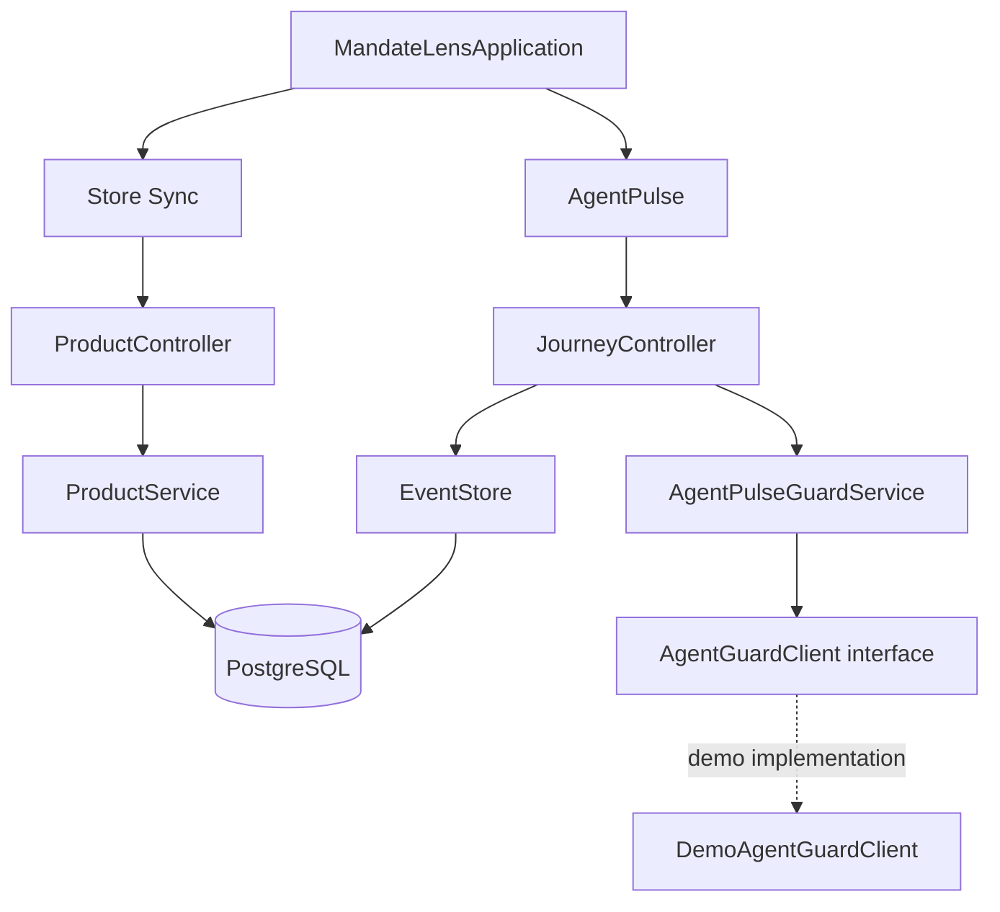

# Mandate Lens

Mandate Lens now contains the Store Sync demo shop and the AgentPulse purchase journey backend. The backend serves the product list, records purchase events, shows a journey timeline, and exposes a draft AgentGuard check. The AgentGuard decision is currently a local demo implementation; it is not connected to the other team's service yet.

## Project layout

- `frontend/` — React shop UI.
- `backend/` — Spring Boot / Java 17 API. Java classes are grouped by feature under `com.emeralds.mandatelens.merchant` and `com.emeralds.mandatelens.agentpulse`.
- `AgentPulse_AgentGuard_Handoff.md` — proposed ownership split and draft interface for the teams to confirm.
- `AgentPulse_Hackathon_Starter_Guide.docx` — project and demo guide.

Backend code layout:

```text
backend/src/main/java/com/emeralds/mandatelens/
  MandateLensApplication.java       # starts the one backend application
  merchant/catalog/                 # PostgreSQL-backed shop catalog API
  merchant/cart/                    # PostgreSQL-backed cart domain and service
  agentpulse/
    api/                            # journey and event HTTP endpoints
    event/                          # PostgreSQL event store, demo data
    guard/                          # replaceable AgentGuard connection
      model/                        # draft request, response, and decision
      service/                      # builds Guard request from a journey
```

This is one Spring Boot backend with separate feature packages. It is not a set of separately deployed services, which keeps the hackathon setup simpler.



The dotted connection is currently a local demo checker. The AgentGuard team can replace it with their confirmed Java module or HTTP client while the journey API remains the AgentPulse entry point.

## Run the backend

Use Java 17+, PostgreSQL, and the included Maven wrapper. Create a database named `mandatelens`; Flyway creates the `merchant` and `trust` schemas and tables from `db_schema.md` on startup. The bundled product CSV seeds an empty catalog once; PostgreSQL is the catalog source after seeding. Store Sync adapter fields not represented in the schema are kept in `merchant.store_sync_cart_state`.

Set `DATABASE_URL`, `DATABASE_USERNAME`, and `DATABASE_PASSWORD` for your PostgreSQL instance. Defaults connect to `jdbc:postgresql://localhost:5432/mandatelens` as `postgres` with password `postgres`.

From the project root in PowerShell:

```powershell
.\mvnw.cmd -pl backend spring-boot:run
```

The API runs at `http://localhost:8080`.

## Run the shop frontend

Open a second terminal:

```powershell
cd frontend
npm install
$env:VITE_API_URL = "http://localhost:8080"
npm run dev
```

Open the local Vite URL shown in the terminal. The shop loads its product list from `GET /api/products`.

## Try the APIs

Health check:

```powershell
curl.exe http://localhost:8080/api/health
```

List shop products:

```powershell
curl.exe http://localhost:8080/api/products
```

Read the seeded purchase journey:

```powershell
curl.exe http://localhost:8080/api/journeys/demo-shoes-001
```

Run the draft AgentGuard check:

```powershell
curl.exe -X POST http://localhost:8080/api/journeys/demo-shoes-001/guard-check `
  -H "Content-Type: application/json" `
  -d '{"journeyId":"demo-shoes-001","shopperLimit":{"amount":200.00,"currency":"USD","source":"simulated_demo"}}'
```

The local demo checker returns `BLOCK` for the seeded $209 total and cites `evt_102`. Change the limit to `$220` to see `ALLOW`. This is sample logic; replace it with the AgentGuard team's confirmed interface and decision service.

Add a sample event to the journey:

```powershell
curl.exe -X POST http://localhost:8080/api/journeys/demo-shoes-001/events `
  -H "Content-Type: application/json" `
  -d '{"id":"evt_103","occurredAt":"2026-10-20T09:05:00Z","type":"checkout_started","source":"simulated_demo","amount":209.00,"currency":"USD","details":"Demo checkout started."}'
```

`add event` means recording something that happened in the purchase timeline; it does not add a product to the shopping cart. The two seeded events and mandate are demo records. They are inserted only when the demo journey has no events and remain in PostgreSQL across restarts.

## Current integration boundaries

- The shop gets product data from the backend's Store Sync product endpoint.
- AgentPulse currently uses seeded demo events. The React cart is not yet connected to the journey event API.
- `AgentGuardClient` is the replaceable connection point. Its current implementation is a local budget-checking demo, not the AgentGuard team's confirmed policy engine.
- PayPal Sandbox checkout is not connected yet. Later, the backend should create and capture orders and record payment status only from PayPal's server response.
- Journey events, mandates, catalog products, carts, cart items, PayPal order/payment references and statuses, and Store Sync adapter state are persisted in PostgreSQL.
