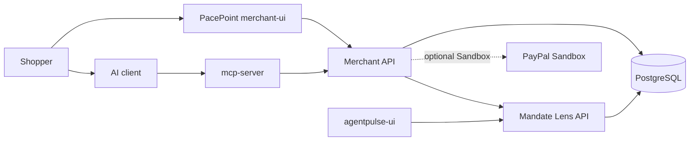

# Mandate Lens

Mandate Lens is a demo commerce system for checking agent-driven shopping actions against a shopper's budget, recording Guard decisions, and showing the resulting journey. **PacePoint** is the customer-facing shop brand. `STRIDEHUB` is its demo merchant ID used by APIs and saved journey records.

## Project description

Mandate Lens demonstrates a safer agent-assisted shopping journey. A shopper asks an AI assistant to find products and provides a budget. The PacePoint shop presents the proposed items and requires the shopper to approve the selection. Merchant then sends the cart to Mandate Lens, where the deterministic demo Guard checks the budget and cart before checkout. The AgentPulse dashboard shows the recorded journey, decisions, and events. Checkout can use a simulated payment or PayPal Sandbox. The demo makes the approval steps visible and keeps the shopper in control; it is not a production payment or authorization system.

## AI and developer tools

The MCP server exposes the PacePoint shop to a compatible AI client. The model can open the shop, interpret the shopping request, and read a saved journey summary. Product selection, cart changes, final Guard review, and payment approval are handled through the shop UI, where the shopper must take the approval actions. The repository does not pin a specific AI model: the connected MCP client supplies it. For the submission, name the exact client and model used in the demo video (see [submission checklist](docs/submission-checklist.md)).

The project is built with Spring Boot/Java, React/Vite, FastMCP/Python, and PostgreSQL. PayPal Sandbox is an optional checkout integration.

## Repository map

| Path | Purpose | Local address |
| --- | --- | --- |
| `src/server/` | Spring Boot APIs for Mandate Lens and Merchant; separate processes built from one Maven module | Mandate Lens `:8081`, Merchant `:8080` |
| `merchant-ui/` | PacePoint shopper-facing store | `http://localhost:5173` |
| `agentpulse-ui/` | AgentPulse journey and decision dashboard | `http://localhost:5174` |
| `mcp-server/` | FastMCP shop used by compatible AI clients | `http://127.0.0.1:8001/mcp` |
| `docs/` | Maintained contributor and user documentation | — |
| `admin-docs/` | Local reference archive; ignored by Git | — |

The merchant service owns the product catalog, cart, and payment adapter. Mandate Lens owns mandates, Guard orchestration, decisions, events, and journey reads. The UIs and MCP server call these APIs; the shop does not own payment credentials or cart pricing.



## Run locally

Prerequisites: Java 17+, Node.js/npm, PostgreSQL, and the included Maven wrapper. For the MCP service, also install Python 3.11+ and `uv`.

1. Create a local PostgreSQL database named `mandatelens`.
2. Copy `.env.example` to `.env` and set the database username/password. Never commit `.env` or live payment credentials.
3. In separate terminals at the repository root, start:

   ```sh
   make run-mandatelens
   make run-merchant
   make run-merchant-ui
   make run-agentpulse-ui
   ```

4. To run MCP, use another terminal:

   ```sh
   cd mcp-server
   uv sync
   uv run fastmcp run server.py --transport http --host 127.0.0.1 --port 8001
   ```

Mandate Lens applies database migrations. Merchant uses the same local database for this demo but does not run migrations. The default checkout is simulated; PayPal Sandbox is optional.

For the full purchase flow—including budget approval, Guard review, optional PayPal Sandbox approval, browser return, capture, and journey verification—follow [the end-to-end shopping guide](docs/end-to-end-shopping-flow.md). For the documentation plan, see [docs/README.md](docs/README.md). Render setup for the MCP payment flow is in [mcp-server/README.md](mcp-server/README.md#paypal-sandbox-from-the-mcp-shop).

Before submitting, use the [submission checklist](docs/submission-checklist.md) to add the public repository, hosted demo or final run instructions, exact AI model/client attribution, license, and YouTube demo link.

## Demo boundaries

- The shopper's budget is a simulated constraint, not a signed or verified AP2 authorization.
- `agentguard-deterministic` is a local demo policy profile; it is not a production authorization service.
- PayPal Sandbox uses test accounts. `PAYPAL_SANDBOX_ENABLED=false` keeps checkout simulated.
- The first service split still uses one Maven module and one shared local PostgreSQL database. See [docs/README.md](docs/README.md) for the maintained documentation areas and planned additions.
