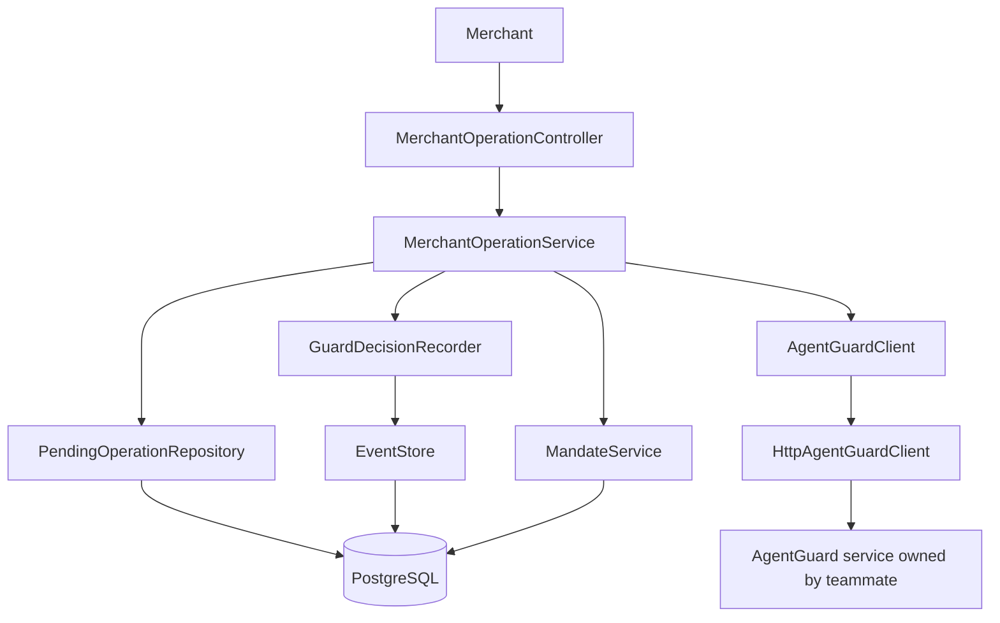
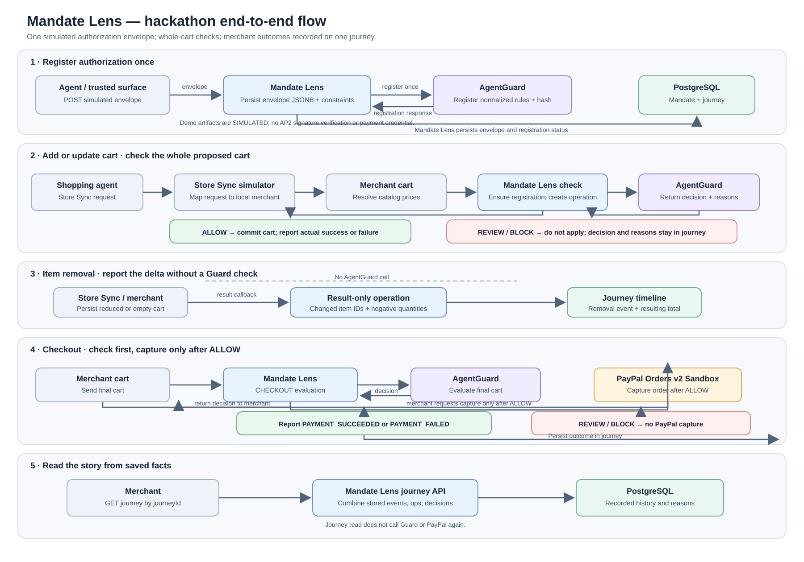

# Mandate Lens

Mandate Lens is the AgentPulse and AgentGuard service under `src/server`; the PacePoint merchant API is a separate Spring process built from the same codebase for this first local split. The merchant calls Mandate Lens over HTTP for checks and reports real cart/payment outcomes. Pulse journey history is shown in its own UI under `mandate-lens-ui`.

## Demo video

[Watch the Mandate Lens demo on YouTube](https://www.youtube.com/watch?v=mcv9rUT9QKo).

## Project layout

- `src/server/` — Spring Boot / Java 17 API and service modules.
- `storefront/` — PacePoint merchant shop UI (port 5173).
- `mandate-lens-ui/` — Mandate Lens Pulse dashboard (port 5174).
- `docs/mandatelens_design.md` — current as-built hackathon architecture and flow overview.
- `docs/database-schemas.md` — all PostgreSQL schemas, tables, columns, keys, and migrations.
- `docs/api-contracts.md` — Mandate Lens, Store Sync simulator, AgentGuard, and simulated mandate contracts.
- `docs/mandatelens_class_diagram.puml` — PlantUML source for the core operation and journey-read flow.
- `AgentPulse_Hackathon_Starter_Guide.docx` — project and demo guide.

Source layout:

```text
src/
  server/src/main/java/com/emeralds/mandatelens/
    MandateLensApplication.java       # Mandate Lens process entry point
    merchant/MerchantApplication.java # separate merchant process entry point
    agentpulse/                       # entry APIs, orchestration, events, operations
    agentguard/                       # separate Guard client and contract models
    mandate/                          # shared trust data used by both modules
    merchant/                         # catalog, cart, Store Sync, PayPal adapter
  server/src/main/resources/          # Spring config and database migrations
storefront/                            # merchant-owned shopper-facing UI
mandate-lens-ui/                       # Mandate Lens-owned Pulse dashboard
```

The two Spring processes currently compile from the same Maven module, but they have separate entry points, Spring scans, ports, and HTTP responsibilities. Merchant owns catalog/cart/payment APIs. Mandate Lens owns Guard orchestration, mandate data, decisions, and Pulse history. They temporarily share one local PostgreSQL database; only Mandate Lens runs migrations. The frontends are separate too: merchant shop at 5173, Pulse dashboard at 5174.



The current hackathon overview is in [docs/mandatelens_design.md](docs/mandatelens_design.md). See [docs/database-schemas.md](docs/database-schemas.md) for the full PostgreSQL schema reference and [docs/api-contracts.md](docs/api-contracts.md) for the mandate and HTTP contracts. The PlantUML diagram covers the core operation and journey-read paths; the AP2 intake and Store Sync simulator flow are detailed in the design document.

For detailed Windows PowerShell instructions to start the backend, merchant UI, MCP server, configure Cursor, and keep PayPal Sandbox disabled, see [docs/windows-local-setup.md](docs/windows-local-setup.md). For API-level end-to-end checks and optional PayPal Sandbox checkout, see [docs/local-e2e.md](docs/local-e2e.md).

For a plain-language bullet summary of the current demo features and what is still a prototype, see [docs/project-changes-summary.md](docs/project-changes-summary.md).



## Run the backend

Use Java 17+, PostgreSQL, and the included Maven wrapper. Create a database named `mandatelens`; Flyway creates the `merchant` and `trust` schemas and tables from migrations under `src/server/src/main/resources/db/migration`. Put local database settings in the ignored repository-root `.env` file; `run-server.ps1` loads the values into the Spring Boot process (Spring Boot does not read this file automatically in this setup). The bundled product CSV seeds an empty catalog once; PostgreSQL is the catalog source after seeding. Store Sync adapter fields not represented in the schema are kept in `merchant.store_sync_cart_state`.

The local `.env` already contains the PostgreSQL URL, username, and your local password. Update those values there if your PostgreSQL setup changes. A safe-to-share template is in `.env.example`.

Start Mandate Lens first, then Merchant, each in a separate PowerShell window from the project root:

```powershell
.\run-server.ps1
```

This starts Mandate Lens at `http://localhost:8081`. In the second window run:

```powershell
.\run-server.ps1 -Service Merchant
```

Merchant API runs at `http://localhost:8080`.

This script loads the root `.env` values into the backend process, then starts Spring Boot. Use it after editing `.env` so the database and demo settings are passed consistently.

On macOS/Linux, start `make run-mandatelens` and `make run-merchant` in separate terminals. Both load the root `.env` and select the correct Spring main class/profile. `make run-storefront` and `make run-pulse-ui` start the two separate frontends.

## Run the shop frontend

On macOS/Linux, start the backend first, then open a second terminal at the project root and run:

```sh
make run-storefront
```

The target installs locked npm dependencies if needed and points the storefront at `http://localhost:8080`.

On Windows PowerShell, open a second terminal:

```powershell
cd storefront
npm ci
npm run dev
```

Run `npm ci` only once, or again after dependencies change.

Open the local Vite URL shown in the terminal. The PacePoint merchant UI loads its products from `GET /api/products` and uses the Store Sync merchant cart endpoints to create/read/update carts and complete PayPal Sandbox checkout. Vite proxies both `/api` and `/merchant-cart` to the local backend, so do not set `VITE_API_URL` for local development. See [docs/local-e2e.md](docs/local-e2e.md) for Sandbox setup.

The Pulse dashboard is a separate UI app under `mandate-lens-ui`. To start it in Windows PowerShell, open another terminal, run `cd mandate-lens-ui`, then `npm ci` once and `npm run dev`. Open `http://localhost:5174`. It lists journeys for the selected merchant (defaults to `STRIDEHUB`) and shows saved activity and Guard decisions. It reads the journey APIs from Mandate Lens on port 8081. The shop header's **Pulse dashboard** link opens it in another browser tab.

For local demo checkout, leave `PAYPAL_SANDBOX_ENABLED=false`; checkout is simulated and does not contact PayPal.

## Try the APIs

Health check:

```powershell
curl.exe http://localhost:8081/api/health
curl.exe http://localhost:8080/api/health
```

List shop products:

```powershell
curl.exe http://localhost:8080/api/products
```

Read the seeded purchase journey:

```powershell
curl.exe "http://localhost:8081/api/v1/journeys/demo-shoes-001?merchantId=STRIDEHUB"
```

Guard decisions use the merchant-facing operation API described below. It evaluates the proposed cart using the configured AgentGuard integration and the journey's stored simulated mandate.

### Merchant-facing AgentPulse check and result API

`POST /api/v1/merchant-operations/check` asks AgentGuard to evaluate an add, update, or checkout using the proposed whole cart. It returns an `operationId` and `ALLOW` or `BLOCK`. After the merchant attempts the action, it calls `POST /api/v1/merchant-operations/{operationId}/result` with a stable `eventId` and the actual result. For item removals, which do not need a Guard check, the merchant can create an operation ID and send the result directly to the same result endpoint.

This API needs an active mandate linked to the journey and a reachable AgentGuard service configured through `agentguard.base-url`. The bundled demo mandate belongs to journey `demo-shoes-001` and merchant `STRIDEHUB`. The current AgentGuard HTTP adapter only permits a loopback URL while the teams agree on authentication.

The hackathon demo accepts one simulated AP2-style authorization envelope at `POST /api/v1/authorizations`. Mandate Lens stores the envelope in the mandate JSONB evidence field and registers its normalized constraints plus an envelope hash with AgentGuard. Each later decision is linked to that authorization hash. The demo does not receive or cryptographically verify a real AP2 mandate or payment credential. See [docs/api-contracts.md](docs/api-contracts.md) for the mandate contract and [docs/database-schemas.md](docs/database-schemas.md) for its persistence.

`GET /api/v1/journeys/{journeyId}?merchantId={merchantId}` returns the saved journey status, operation statuses, Guard decisions and reasons, and ordered event timeline. For example, the seeded demo journey can be read with `GET /api/v1/journeys/demo-shoes-001?merchantId=STRIDEHUB`. The merchant ID match is a local demo ownership check; use authenticated merchant identity before exposing this endpoint outside localhost.

Add a sample event to the journey:

```powershell
curl.exe -X POST http://localhost:8081/api/journeys/demo-shoes-001/events `
  -H "Content-Type: application/json" `
  -d '{"id":"evt_103","occurredAt":"2026-10-20T09:05:00Z","type":"checkout_started","source":"simulated_demo","amount":209.00,"currency":"USD","details":"Demo checkout started."}'
```

`add event` means recording something that happened in the purchase timeline; it does not add a product to the shopping cart. The two seeded events and mandate are demo records. They are inserted only when the demo journey has no events and remain in PostgreSQL across restarts.

## Current integration boundaries

- The shop gets product data from the backend's Store Sync product endpoint.
- The React storefront now runs a complete local demo of the simulated AI-agent proposal, Guard check, merchant result callback, checkout check, and simulated payment callback. The journey panel reads its history from `GET /api/v1/journeys/{journeyId}?merchantId=STRIDEHUB`.
- The Cursor MCP demo asks for a budget first when none was provided. Only after the shopper enters it does the UI search Merchant, show one affordable shoe and the requested quantity, and ask the shopper to approve that item. A stated budget lets it search and show the item immediately for approval. Merchant/Guard then checks the cart; checkout still needs a separate review and approval.
- The default merchant operation API calls the configured AgentGuard HTTP client. The other team's policy service must be running for external Guard decisions; `agentguard-deterministic` provides a local policy demo, and `storesync-sandbox-test` provides a permissive stub for protocol testing.
- The `storesync-simulator` path uses the same operation check/result orchestration for cart create, cart replace, removals, and checkout, then can call PayPal Orders v2 Sandbox when configured.
- Journey events, mandates, catalog products, carts, cart items, PayPal order/payment references and statuses, and Store Sync adapter state are persisted in PostgreSQL.
