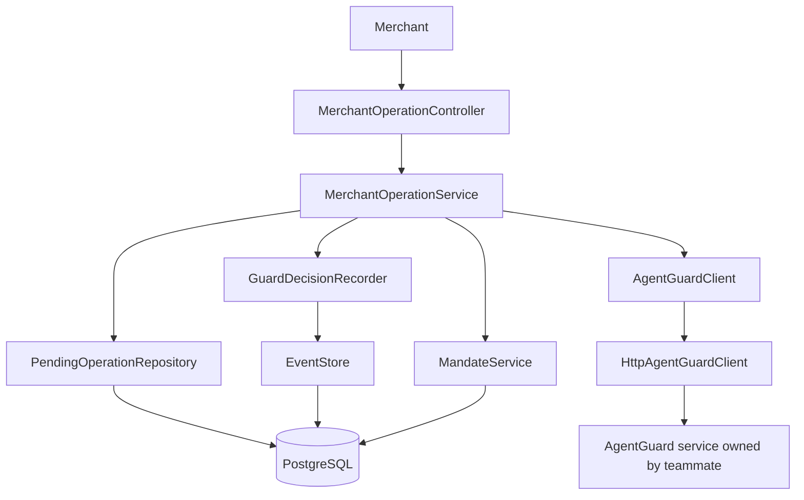

# Mandate Lens

Mandate Lens is the Spring Boot service under `src/server`. It exposes a merchant-facing operation check/result API that calls the configured AgentGuard HTTP service and records decisions and merchant outcomes in PostgreSQL. The older `/api/journeys/{id}/guard-check` endpoint remains a local demo checker. The local Store Sync simulator is still a separate path and is not yet wired through the new merchant-facing API. The optional React storefront lives under `demo/storefront` and is for presentations only.

## Project layout

- `src/server/` — Spring Boot / Java 17 API and service modules.
- `demo/storefront/` — optional React shop used only to demonstrate shopping; it is not a Mandate Lens service.
- `docs/mandatelens_class_diagram.puml` — PlantUML class diagram for the entry flow and module ownership.
- `AgentPulse_AgentGuard_Handoff.md` — proposed ownership split and draft interface for the teams to confirm.
- `AgentPulse_Merchant_Integration_Design.md` — current merchant-facing check/result design and sequence diagrams.
- `AgentPulse_Hackathon_Starter_Guide.docx` — project and demo guide.

Source layout:

```text
src/
  server/src/main/java/com/emeralds/mandatelens/
    MandateLensApplication.java       # starts the one backend application
    agentpulse/                       # entry APIs, orchestration, events, operations
    agentguard/                       # separate Guard client and contract models
    mandate/                          # shared trust data used by both modules
    merchant/                         # catalog, cart, Store Sync, PayPal adapter
    demo/legacyguard/                 # local budget-check demo, separate from AgentGuard client
  server/src/main/resources/          # Spring config and database migrations
demo/
  storefront/                         # optional shopper-facing demo UI, outside the services
```

The `src/` directory contains the Spring Boot services. AgentPulse owns the entry API, pending operations, and journey history. The separate AgentGuard area owns only its client and request/response contract here; the policy engine itself is owned by the other teammate/service. `demo/storefront/` is an optional sample shop for presentations; it is not part of the service architecture.



The PlantUML class diagram with the entry flow and class responsibilities is in `docs/mandatelens_class_diagram.puml`. The older local budget-check demo remains under `src/server/src/main/java/com/emeralds/mandatelens/demo/legacyguard`.

## Run the backend

Use Java 17+, PostgreSQL, and the included Maven wrapper. Create a database named `mandatelens`; Flyway creates the `merchant` and `trust` schemas and tables from migrations under `src/server/src/main/resources/db/migration`. The bundled product CSV seeds an empty catalog once; PostgreSQL is the catalog source after seeding. Store Sync adapter fields not represented in the schema are kept in `merchant.store_sync_cart_state`.

Set `DATABASE_URL`, `DATABASE_USERNAME`, and `DATABASE_PASSWORD` for your PostgreSQL instance. Defaults connect to `jdbc:postgresql://localhost:5432/mandatelens` as `postgres` with password `postgres`.

From the project root in PowerShell:

```powershell
.\mvnw.cmd -pl src/server spring-boot:run
```

The API runs at `http://localhost:8080`.

## Run the shop frontend

Open a second terminal:

```powershell
cd demo/storefront
npm install
$env:VITE_API_URL = "http://localhost:8080"
npm run dev
```

Open the local Vite URL shown in the terminal. The shop loads its product list from `GET /api/products`.

## Try the APIs

Health check:

```powershell
curl.exe http://localhost:8080/api/health
```

List shop products:

```powershell
curl.exe http://localhost:8080/api/products
```

Read the seeded purchase journey:

```powershell
curl.exe http://localhost:8080/api/journeys/demo-shoes-001
```

Run the draft AgentGuard check:

```powershell
curl.exe -X POST http://localhost:8080/api/journeys/demo-shoes-001/guard-check `
  -H "Content-Type: application/json" `
  -d '{"journeyId":"demo-shoes-001","shopperLimit":{"amount":200.00,"currency":"USD","source":"simulated_demo"}}'
```

The local demo checker returns `BLOCK` for the seeded $209 total and cites `evt_102`. Change the limit to `$220` to see `ALLOW`. This endpoint uses sample logic and is separate from the merchant-facing Guard integration.

### Merchant-facing AgentPulse check and result API

`POST /api/v1/merchant-operations/check` asks AgentGuard to evaluate an add, update, or checkout using the proposed whole cart. It returns an `operationId` and `ALLOW` or `BLOCK`. After the merchant attempts the action, it calls `POST /api/v1/merchant-operations/{operationId}/result` with a stable `eventId` and the actual result. For item removals, which do not need a Guard check, the merchant can create an operation ID and send the result directly to the same result endpoint.

This API needs an active mandate linked to the journey and a reachable AgentGuard service configured through `agentguard.base-url`. The bundled demo mandate belongs to journey `demo-shoes-001` and merchant `STRIDEHUB`. The current AgentGuard HTTP adapter only permits a loopback URL while the teams agree on authentication.

`GET /api/v1/journeys/{journeyId}?merchantId={merchantId}` returns the saved journey status, operation statuses, Guard decisions and reasons, and ordered event timeline. For example, the seeded demo journey can be read with `GET /api/v1/journeys/demo-shoes-001?merchantId=STRIDEHUB`. The merchant ID match is a local demo ownership check; use authenticated merchant identity before exposing this endpoint outside localhost.

Add a sample event to the journey:

```powershell
curl.exe -X POST http://localhost:8080/api/journeys/demo-shoes-001/events `
  -H "Content-Type: application/json" `
  -d '{"id":"evt_103","occurredAt":"2026-10-20T09:05:00Z","type":"checkout_started","source":"simulated_demo","amount":209.00,"currency":"USD","details":"Demo checkout started."}'
```

`add event` means recording something that happened in the purchase timeline; it does not add a product to the shopping cart. The two seeded events and mandate are demo records. They are inserted only when the demo journey has no events and remain in PostgreSQL across restarts.

## Current integration boundaries

- The shop gets product data from the backend's Store Sync product endpoint.
- AgentPulse currently uses seeded demo events. The React cart is not yet connected to the journey event API.
- The legacy journey check uses a local budget demo. The new merchant-facing operation API calls the configured AgentGuard HTTP client; the other team's policy service must be running for it to return a decision.
- The `storesync-simulator` path can call PayPal Orders v2 Sandbox when configured. It is not yet connected to the new operation check/result API.
- Journey events, mandates, catalog products, carts, cart items, PayPal order/payment references and statuses, and Store Sync adapter state are persisted in PostgreSQL.
