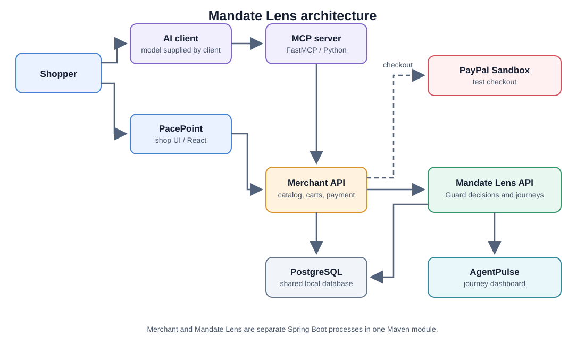

# Architecture overview

Mandate Lens is a demo commerce system for an agent-assisted shopping flow with shopper approvals and a recorded policy decision trail. It runs as several services from one repository. The Merchant API and Mandate Lens API are separate Spring Boot processes built from the same Maven module; in the demo they share a PostgreSQL database.

## Service responsibilities

| Service | Responsibilities and ownership | Local address |
| --- | --- | --- |
| PacePoint storefront (`merchant-ui/`) | Presents the product catalog and proposed selection; collects the shopper's selection and checkout approvals; handles the browser return from PayPal and starts capture through Merchant. Calls the Merchant API. | `http://localhost:5173` |
| Merchant API (`src/server/`, merchant profile) | Owns the merchant catalog and carts, orchestrates cart changes and checkout, calls Mandate Lens for Guard checks, and creates/captures PayPal Sandbox orders. | `http://localhost:8080` |
| Mandate Lens API (`src/server/`, Mandate Lens profile) | Owns shopping sessions and mandate data; evaluates cart and checkout requests with the deterministic demo Guard; records merchant operations, decisions, and events; serves journey reads to AgentPulse and MCP. | `http://localhost:8081` |
| AgentPulse dashboard (`agentpulse-ui/`) | Reads journey, operation, decision, and event data from Mandate Lens and presents the outcome for inspection. It does not create or authorize purchases. | `http://localhost:5174` |
| MCP server (`mcp-server/`) | Connects a compatible AI client to the shop app and the selected MCP actions. Reads products through Merchant and journey summaries through Mandate Lens. It keeps a small in-memory session-to-cart pointer; durable carts and journeys belong to the APIs and database. | `http://127.0.0.1:8001/mcp` |
| PostgreSQL | Stores the demo catalog, carts, shopping data, decisions, and journey events. Both APIs use the `mandatelens` database; Mandate Lens owns its Flyway migrations. | `localhost:5432` |
| PayPal Sandbox | Provides the buyer approval and test order capture path used by the end-to-end procedure. It does not move real money. | External Sandbox service |

## Hosted service URLs

| Service | Public URL |
| --- | --- |
| PacePoint storefront | [mandate-lens-store.onrender.com](https://mandate-lens-store.onrender.com) |
| AgentPulse dashboard | [mandate-lens-agentpulse.onrender.com](https://mandate-lens-agentpulse.onrender.com) |
| MCP endpoint | [mandate-lens-mcp.onrender.com/mcp](https://mandate-lens-mcp.onrender.com/mcp) |
| Merchant API | [mandate-lens-merchant.onrender.com](https://mandate-lens-merchant.onrender.com) |
| Mandate Lens API | [mandate-lens-api.onrender.com](https://mandate-lens-api.onrender.com) |

## Request and data flow

1. The AI client connects to the MCP server. The model can interpret the request, open the shop, and request a saved journey summary.
2. The shopper reviews the proposed items and approves the selection in the shop UI. Cart and payment actions are also performed by the shopper in the UI.
3. Merchant obtains product and cart data and asks Mandate Lens to evaluate the proposed cart against the demo budget and policy.
4. Mandate Lens records the decision and related journey events. AgentPulse reads these records and presents the flow.
5. Before checkout, the shopper requests a final Guard review. After an ALLOW result, Merchant creates a PayPal Sandbox order. The shopper approves it, and the PacePoint storefront handles the browser return and capture.

The model does not directly approve the selection, change the cart, authorize the Guard result, or approve payment. Those actions require the shopper in the UI.

## Demo Guard policies

The local `agentguard-deterministic` profile applies explicit rules to the stored mandate and proposed cart. It does not use an AI model to make the Guard decision. The shopper's budget is recorded as a simulated constraint; it is not signed or verified AP2 authorization evidence.

| Rule area | What the Guard checks | Result when the check fails or needs more data |
| --- | --- | --- |
| Mandate and journey | A mandate exists for the journey, is linked to it, and has not expired. The local demo accepts simulated mandate sources only. | Missing or expired mandate blocks. Unverified mandate evidence returns `REVIEW`. |
| Amount and currency | The cart currency matches the mandate currency, and the cart total is no greater than the mandate maximum. | Mismatch or over-limit amount blocks. Missing amount data returns `REVIEW`. |
| Product authorization | If the mandate restricts product IDs or categories, every item must be allowed. Each item must have a valid ID, category, positive quantity, and unit price. | Unauthorized or malformed items block. |
| Catalog integrity | Product IDs must exist in the live Merchant catalog. Submitted category, unit price, and currency must match catalog data. | Missing products or altered product facts block. |
| Shipping | If the mandate specifies a country, checkout must include the same country. If no country is specified, shipping is unrestricted. | A different country blocks; missing required shipping country at checkout returns `REVIEW`. |
| Checkout cart | The cart must contain at least one item at checkout. | Empty cart blocks. |

The decision aggregator returns `BLOCK` if any rule blocks, otherwise `REVIEW` if any rule needs review, and `ALLOW` only when no rule blocks or requests review. The result includes rule findings and reasons for the UI and journey record. Payment approval is only offered after the final checkout review returns `ALLOW`; the shopper still approves the PayPal Sandbox order separately.

In this demo, anomaly evaluation is configured `OFF`. See the [deterministic rules](../src/server/src/main/java/com/emeralds/mandatelens/agentguard/service/DeterministicRuleEvaluator.java), [catalog integrity rule](../src/server/src/main/java/com/emeralds/mandatelens/agentguard/service/CatalogIntegrityRuleEvaluator.java), and [decision aggregation](../src/server/src/main/java/com/emeralds/mandatelens/agentguard/service/DecisionAggregator.java) for implementation details.

## Data ownership and migrations

The local demo uses one PostgreSQL database named `mandatelens`. Mandate Lens owns and applies the Flyway migrations in `src/server/src/main/resources/db/migration/`; Merchant uses the same database and does not run migrations. Database connection settings are supplied through `DATABASE_URL`, `DATABASE_USERNAME`, and `DATABASE_PASSWORD`. See the [environment template](../.env.example) and the [end-to-end setup guide](end-to-end-shopping-flow.md).

The `STRIDEHUB` value is the demo merchant ID used by APIs and saved journey records. The customer-facing store brand is PacePoint.

## Demo limits

- The budget is a simulated constraint, not a signed or verified AP2 authorization.
- `agentguard-deterministic` is a local demo policy profile, not a production authorization service.
- PayPal Sandbox uses test accounts and does not move real money.
- The services share a Maven module and local database in this demo; this is not a production deployment topology.

## Running the services

The service responsibilities are the same for local and hosted runs. For clone instructions, local startup commands, hosted URLs, and the complete purchase procedure, see the [run and end-to-end guide](end-to-end-shopping-flow.md).

## Related guides

- [Run the complete interactive flow](end-to-end-shopping-flow.md).
- [MCP server setup and deployment notes](../mcp-server/README.md).
- [Project overview and AI tool attribution](../README.md).
