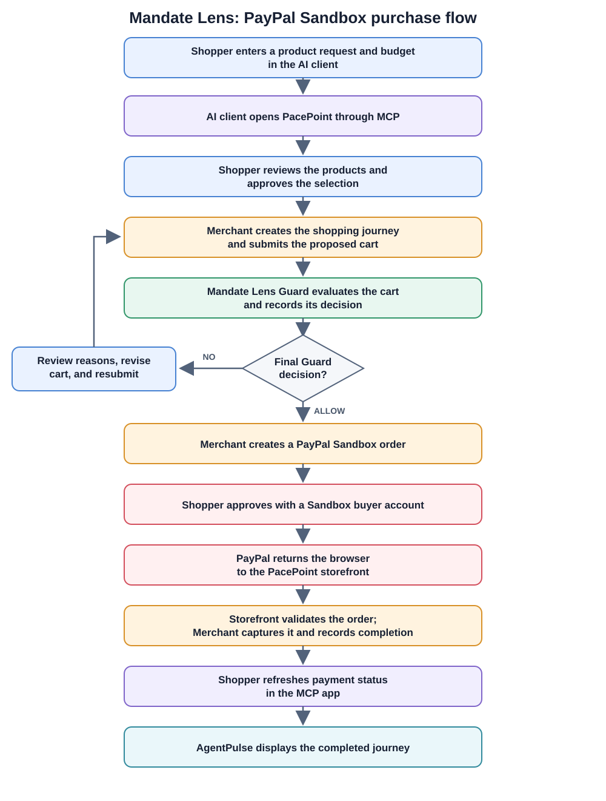

# Run the demo: clone, start, and complete a purchase

This procedure takes you from a clean repository clone to a completed PayPal Sandbox purchase and an AgentPulse journey. Choose the hosted route if you do not want to install the local stack. Both routes use the same shopper approvals and checkout flow.

The shopper budget and Guard policy are simulated. PayPal Sandbox uses test accounts and does not move real money.

## End-to-end flow



The store brand is **PacePoint**. `STRIDEHUB` is the demo merchant ID used in APIs and saved journey records.

## Option 1: Use the hosted demo

The services are deployed on Render. Use these public URLs to open the pages and connect an MCP client:

| Service | Public URL |
| --- | --- |
| PacePoint storefront (`mandate-lens-stpre`) | [https://mandate-lens-store.onrender.com](https://mandate-lens-store.onrender.com) |
| AgentPulse dashboard (`mandate-lens-pulse`) | [https://mandate-lens-agentpulse.onrender.com](https://mandate-lens-agentpulse.onrender.com) |
| MCP endpoint (`mandate-lens-mcp`) | [https://mandate-lens-mcp.onrender.com/mcp](https://mandate-lens-mcp.onrender.com/mcp) |
| Merchant API (`mandate-lens-merchant`) | [https://mandate-lens-merchant.onrender.com](https://mandate-lens-merchant.onrender.com) |
| Mandate Lens API (`mandate-lens-api`) | [https://mandate-lens-api.onrender.com](https://mandate-lens-api.onrender.com) |

### Restart and check hosted services

Before a hosted demo, open the Render dashboard and restart the web services `mandate-lens-api`, `mandate-lens-merchant`, and `mandate-lens-mcp`. Wait until each shows **Live**. For the static sites `mandate-lens-store` and `mandate-lens-pulse`, confirm their latest deploy is **Live**; static sites do not have an app process to restart.

Then check that both APIs are responding:

```sh
curl -i https://mandate-lens-api.onrender.com/api/health
curl -i https://mandate-lens-merchant.onrender.com/api/health
curl -i https://mandate-lens-merchant.onrender.com/api/products
```

### Connect to the hosted MCP server

Use an MCP client that supports MCP Apps, such as Cursor or Codex. Add the hosted MCP endpoint from the table to the client's MCP server settings. For Codex CLI, for example:

```sh
codex mcp add mandate-lens-demo --url https://mandate-lens-mcp.onrender.com/mcp
```

For Cursor, add the same endpoint in MCP settings. Reload or reconnect the MCP server after saving it. The MCP panel opens the PacePoint shopping app inside the client.

### Complete a hosted purchase

1. Ask the connected AI client: “Buy one pair of running shoes for up to $200. Show me the selection and wait for my approval.”
2. Review the proposed products, quantity, and total in the PacePoint app. Enter the budget if prompted, then click **Approve selection and add to cart**.
3. Review the saved cart and click **Check final cart with Guard**. Continue only if the decision is `ALLOW`.
4. Click **Open PayPal Sandbox approval** and sign in with a PayPal Sandbox buyer account. Approve the order.
5. PayPal returns the browser to the hosted PacePoint storefront. Wait for the page to confirm checkout, then return to the MCP panel and click **I approved in PayPal — check payment status**.
6. Open AgentPulse using the URL above and confirm the completed journey appears.

The hosted Merchant service must already have PayPal Sandbox credentials and public storefront return/cancel URLs configured. Judges need a Sandbox buyer account to approve the order; they should not need server credentials. See the [MCP deployment notes](../mcp-server/README.md#paypal-sandbox-from-the-mcp-shop) for service configuration.

## Option 2: Clone and run locally

### Prerequisites

- Git.
- Java 17 or newer and the included Maven wrapper.
- Node.js and npm.
- PostgreSQL.
- Python 3.11 or newer and `uv` for the MCP server.
- An MCP client that supports MCP Apps, such as Cursor or Codex.
- A PayPal Sandbox REST app and a Sandbox buyer account.

### Clone the repository

```sh
git clone https://github.com/neha702/mandate-lens.git
cd mandate-lens
```

The commands below use Bash and `make` on macOS/Linux. On Windows, use PowerShell commands shown in the relevant steps.

### Create the database and configure local settings

Start PostgreSQL and create a local database named `mandatelens`. Replace `postgres` with your local PostgreSQL role if needed:

```sh
createdb -U postgres mandatelens
```

If the database already exists, keep using it. Copy the environment template:

```sh
cp .env.example .env
```

PowerShell:

```powershell
Copy-Item .env.example .env
```

You must create the PostgreSQL database once; Flyway connects to that database and does not create the database itself. You do not need to create the `merchant` or `trust` schemas or their tables manually: the Mandate Lens Flyway migrations create them. The configured PostgreSQL role must be able to connect to `mandatelens` and create schemas/tables. For a local demo, using the `postgres` role as the database owner is the simplest setup.

Edit `.env` and set `DATABASE_URL`, `DATABASE_USERNAME`, and `DATABASE_PASSWORD` to match your local database. For example, if `postgres` owns the database, use `DATABASE_USERNAME=postgres` and the password configured for that PostgreSQL role. Set these PayPal Sandbox values before starting Merchant:

```text
PAYPAL_SANDBOX_ENABLED=true
PAYPAL_ORDERS_BASE_URL=https://api-m.sandbox.paypal.com
PAYPAL_ORDERS_CLIENT_ID=<Sandbox REST app client ID>
PAYPAL_ORDERS_CLIENT_SECRET=<Sandbox REST app secret>
PAYPAL_ORDERS_RETURN_URL=http://localhost:5173/checkout/return
PAYPAL_ORDERS_CANCEL_URL=http://localhost:5173/checkout/cancel
```

Keep `.env` local. Do not commit Sandbox credentials or real payment credentials. Mandate Lens runs the Flyway migrations and seeds demo data; Merchant uses the same database and does not run migrations.

### Start each local service

Open a separate terminal for each command. From the repository root on macOS/Linux, start the two APIs and web interfaces:

```sh
make run-mandatelens
make run-merchant
make run-merchant-ui
make run-agentpulse-ui
```

On Windows PowerShell, start the APIs in separate terminals:

```powershell
.\run-server.ps1 -Service MandateLens
```

```powershell
.\run-server.ps1 -Service Merchant
```

Start the two web interfaces in separate terminals:

```powershell
npm ci --prefix merchant-ui
npm --prefix merchant-ui run dev -- --host 127.0.0.1
```

```powershell
npm ci --prefix agentpulse-ui
npm --prefix agentpulse-ui run dev -- --host 127.0.0.1
```

Start MCP from another terminal. The `uv sync` command installs its dependencies:

```sh
cd mcp-server
uv sync
uv run fastmcp run server.py --transport http --host 127.0.0.1 --port 8001
```

Expected local addresses:

| Service | Local URL |
| --- | --- |
| PacePoint storefront | `http://localhost:5173` |
| AgentPulse dashboard | `http://localhost:5174` |
| Merchant API | `http://localhost:8080` |
| Mandate Lens API | `http://localhost:8081` |
| MCP endpoint | `http://127.0.0.1:8001/mcp` |

Check that both APIs are ready and Merchant can return products:

```sh
curl -i http://localhost:8081/api/health
curl -i http://localhost:8080/api/health
curl -i http://localhost:8080/api/products
```

### Connect your local MCP client

Add `http://127.0.0.1:8001/mcp` as an MCP server in Cursor or your MCP Apps client, then reload or reconnect it. The repository includes a Cursor config for this local address. For Codex CLI, use:

```sh
codex mcp add mandate-lens-demo --url http://127.0.0.1:8001/mcp
```

## Complete the purchase

Use these steps with either the hosted or local MCP app:

1. Ask the AI client: “Buy one pair of running shoes for up to $200. Show me the selection and wait for my approval.”
2. Review the proposed items, quantity, and total in the PacePoint app. Enter the budget if requested. Click **Approve selection and add to cart**.
3. Click **Check final cart with Guard** and inspect the result. Payment approval should only be available after `ALLOW`.
4. Click **Open PayPal Sandbox approval**, sign in using a Sandbox buyer account, and approve the order.
5. PayPal returns the browser to the PacePoint storefront. Wait for its success confirmation, then return to the MCP panel and click **I approved in PayPal — check payment status**.
6. Open AgentPulse and verify that the journey shows the completed cart and payment result.

Selection approval and payment approval are separate shopper actions. The budget is a demo constraint, not cryptographically verified AP2 authorization.

## Verify the saved purchase locally

For a local run, use the cart and journey IDs returned by the MCP app:

```sh
curl -i http://localhost:8080/merchant-cart/<cart-id>
curl -i 'http://localhost:8081/api/v1/journeys/<journey-id>?merchantId=STRIDEHUB'
```

The cart should have `status: "COMPLETED"`. The journey should show the cart and final payment outcome.

## Troubleshooting

| Symptom | Check |
| --- | --- |
| Product list fails | Merchant is running; `GET /api/products` returns 200; MCP `MERCHANT_API_BASE_URL` points to Merchant. |
| Shopping session fails | Merchant `MANDATELENS_API_BASE_URL` points to Mandate Lens; inspect both API logs. |
| Checkout preview is blocked | Read the Guard decision and reasons; revise the cart and request another review. |
| PayPal approval is unavailable | Merchant has `PAYPAL_SANDBOX_ENABLED=true` and Sandbox REST credentials; restart Merchant after local `.env` changes. |
| PayPal returns to a 404 | Confirm the return URL points to the PacePoint storefront. For a hosted static site, configure a rewrite from `/*` to `/index.html`. |
| MCP still shows payment pending | Confirm the storefront callback completed capture, then refresh payment status in the MCP panel. |
| AgentPulse has no completed journey | Confirm payment status completed and check that AgentPulse points to the hosted or local Mandate Lens API for this run. |

For hosted environment-variable ownership, callback URLs, and MCP scaling notes, see the [MCP deployment notes](../mcp-server/README.md#paypal-sandbox-from-the-mcp-shop).
