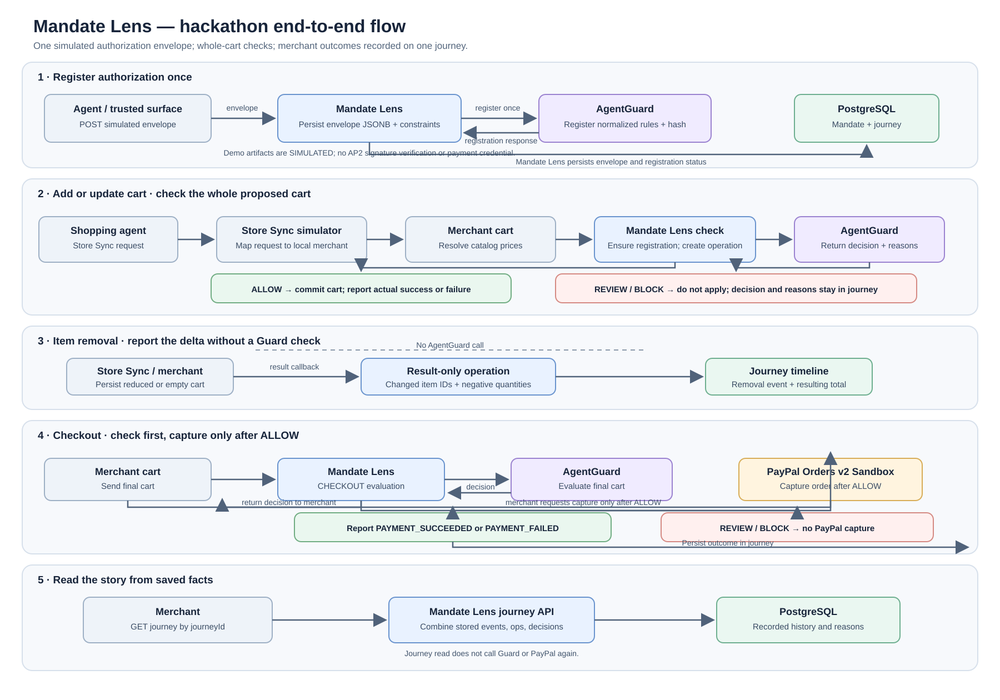

# Mandate Lens Hackathon Design

**Status:** Current design for the hackathon demo; describes the code in this repository.
**Last reviewed:** 2026-10-25

This document is the current reference for the demo architecture, AP2-style authorization envelope, data storage, and merchant API.

## 1. What the demo shows

Mandate Lens demonstrates how a merchant can check an agent-driven shopping action against a shopper authorization, then record what actually happened. The demo uses a local Store Sync simulator and a simulated merchant called STRIDEHUB. It does not connect to a real merchant or receive real PayPal AP2 authorization evidence.

The backend is one Spring Boot application with clear package boundaries:

| Area | Responsibility |
|---|---|
| `merchant/` | Product catalog, cart and order state, Store Sync simulator, PayPal Orders adapter. |
| `mandate/` | Authorization envelope intake, normalized constraints, mandate and journey linkage. |
| `agentguard/` | AgentGuard request/response contracts, HTTP client, and local demo implementations. |
| `agentpulse/` | Merchant check/result APIs, operation lifecycle, decisions, events, and journey reads. |
| `storefront/` | Presentation-only React storefront; it is not the merchant integration or policy service. |

## 2. Journey and cart model

Use one journey for a shopping task. The journey timeline contains the task's cart actions, Guard decisions, merchant outcomes, and payment result. Each Guard check evaluates the **whole proposed cart**, not one item in isolation. A first add is checked as an empty current cart plus the proposed cart; a checkout checks the final cart again.

Pure removals and quantity decreases do not need a Guard call. Mandate Lens still records a result event with the removed product IDs, negative quantity deltas, and the resulting total. If the last item is removed, the merchant cart becomes empty and the journey can remain available for another action.

The Store Sync simulator currently uses the configured demo journey (`agentguard.demo.journey-id`, default `demo-shoes-001`). It is meant for a single demo shopping task at a time. A production or multi-session integration must map each external shopping session to its own journey and cart.

## 3. Authorization envelope and AP2 terms

`POST /api/v1/authorizations` accepts one Mandate Lens envelope containing authorization metadata, an array of AP2-style artifacts, and the normalized policy projection. The envelope is stored as JSONB on the mandate. Its contract can carry open or closed Checkout and Payment artifacts, but the current Store Sync simulator does not obtain or append closed checkout/payment artifacts from PayPal; the seeded example contains only a simulated open Checkout artifact.

The envelope is a **Mandate Lens transport/storage wrapper**, not an AP2 wire format. The demo fixture uses `provenance: SIMULATED`, fabricated references and hashes, and `verificationStatus: SIMULATED`. No signature or issuer verification is performed. AgentGuard receives the authorization reference and hash plus normalized constraints, not the complete evidence or a payment credential.

The current AP2 v0.2 specification calls the artifacts Checkout Mandates and Payment Mandates, with open and closed forms. Its `vct` values are `mandate.checkout.open.1`, `mandate.checkout.1`, `mandate.payment.open.1`, and `mandate.payment.1`. PayPal's overview also uses Cart Mandate for a human-present flow and Intent Mandate for human-not-present intent. Keep those PayPal terms distinct from the AP2 v0.2 artifact names; the demo's `AUTONOMOUS` mode and open Checkout artifact are a simplified representation, not proof of compatibility with a live PayPal authorization flow. See the [AP2 specification](https://github.com/google-agentic-commerce/AP2/blob/main/docs/ap2/specification.md), [Checkout Mandate](https://github.com/google-agentic-commerce/AP2/blob/main/docs/ap2/checkout_mandate.md), [Payment Mandate](https://github.com/google-agentic-commerce/AP2/blob/main/docs/ap2/payment_mandate.md), and [PayPal's AP2 overview](https://developer.paypal.com/community/blog/PayPal-Agent-Payments-Protocol/).

The cart is intentionally not copied into the envelope. Merchant cart lines change during shopping and belong in `merchant.carts` and `merchant.cart_items`; every check carries the current and proposed cart snapshot. `journeyId`, `cartId`, `authorizationId`, artifact references, and checkout hashes correlate the evidence without storing two conflicting cart versions.

`normalizedConstraints.maxAmount` is the demo's per-checkout ceiling. AP2 distinguishes a payment `amount_range` for one payment from a cumulative `budget` used with recurrence constraints. The demo does not model recurring payment mandates. Category, product ID, and shipping-country fields are Mandate Lens policy projection fields unless they are explicitly present in source authorization claims.

## 4. End-to-end flow

For a blocked check, the decision and reasons are already written to the journey. The operation is marked `NOT_APPLIED`; the Store Sync simulator returns a conflict to its caller and does not send a result callback for the blocked action. A later journey read can show the block and its rule findings.

## 5. Current HTTP contracts

| Endpoint | Caller and purpose |
|---|---|
| `POST /api/v1/authorizations` | Demo authorization intake; saves the envelope and registers normalized constraints with AgentGuard. |
| `POST /api/v1/merchant-operations/check` | Merchant check for `ADD_ITEM`, `UPDATE_CART`, or `CHECKOUT`; includes current and proposed whole-cart snapshots. |
| `POST /api/v1/merchant-operations/{operationId}/result` | Merchant result callback for successful/failed cart, removal, and payment outcomes. Stable `eventId` deduplicates retries. |
| `GET /api/v1/journeys/{journeyId}?merchantId=...` | Read stored journey status, operations, Guard decisions, reasons, and timeline. |
| `POST /merchant-cart` | Local Store Sync simulator: create and check an initial cart. |
| `PUT /merchant-cart/{cartId}` | Replace cart contents; an empty `items` list clears the cart. |
| `POST /merchant-cart/{cartId}/checkout` | Check the final cart and, only after `ALLOW`, capture its PayPal order. |

The Store Sync routes are enabled only in the `storesync-simulator` profile and bind to loopback. They have no Store Sync JWT verification. The journey read API's `merchantId` check is a demo ownership check, not merchant authentication.

## 6. Persistence changes

The schema builds on existing tables rather than making a second cart store:

Keep the schema names `merchant` and `trust`. `merchant` holds the merchant-owned commerce state; `trust` holds authorization, journey, decision, operation, and audit state. These names make the current ownership split clear. Renaming `merchant` to `commerce` is a reasonable option only if the product later grows into a multi-channel commerce platform; it is not needed for this demo and would require changing the migrations and SQL references. Schema names do not provide tenant isolation by themselves.

| Migration | Relevant data |
|---|---|
| V1 | `trust.mandates.authorization_evidence` JSONB and `authorization_reference`; `trust.trust_journeys`; merchant carts/cart items/orders/payments; JSONB journey event details; journey/cart correlation fields. |
| V2 | `trust.pending_operations` and `trust.merchant_callback_events` for operation state, idempotency, and callback deduplication. |
| V3 | `trust.mandates.allowed_product_ids` and `agentguard_registered_at` so Guard registration can be tracked and repeated when registered constraints/evidence change. |

Removal deltas and payment references are stored in the existing callback/event JSONB details. Card data, bearer credentials, and raw payment tokens are not stored in the mandate envelope.

## 7. Runtime modes and demo limits

- `storesync-simulator` calls PayPal Orders v2 Sandbox when sandbox credentials are configured. It is loopback-only and has no real Store Sync signature verification.
- `storesync-sandbox-test` supplies a local permissive AgentGuard stub for protocol testing.
- `agentguard-deterministic` enables the local deterministic policy service for a controlled demo. The external HTTP client is the default integration boundary and is loopback-only until AgentGuard authentication is agreed.
- The bundled mandate and authorization artifacts are seeded demo records for `demo-shoes-001` / `STRIDEHUB`.
- The simulator records PayPal capture responses as payment outcomes; it does not verify PayPal webhooks or ingest actual AP2 authorization evidence.
- The last-item removal path clears local pending-order state but does not call PayPal to cancel/void the remote order. Cart/order creation or update errors can also happen after the merchant cart has been saved, so a real integration needs reconciliation.
- Payment result reporting is synchronous after capture. Durable retry/outbox handling is needed so a successful PayPal capture cannot be left without its Mandate Lens event if reporting fails.
- The React app in `storefront/` reads catalog data for a presentation. It is not wired to the Store Sync cart or merchant operation APIs.

## 8. Before a real merchant/AP2 integration

1. Define how each external commerce session maps to a unique journey and cart.
2. Agree the merchant and AgentGuard API contracts and authenticate both callers.
3. Replace simulated artifacts with AP2 evidence from an authorized source and implement issuer/signature, expiry, and binding verification.
4. Preserve the AP2 artifacts and their verification results; keep the normalized AgentGuard projection traceable to the verified source.
5. Connect authoritative PayPal event handling, including webhook verification and reconciliation of payment result callbacks.
6. Add recovery so a successful PayPal capture cannot be left without its corresponding Mandate Lens result event if result reporting is interrupted.
7. Test Flyway migrations and full cart-to-payment flows against the intended database and PayPal Sandbox setup.

## 9. Related project docs

- [README and local run instructions](../README.md)
- [Rendered end-to-end flow diagram](hackathon-flow.svg)
- [Core operation and journey-read diagram source](mandatelens_class_diagram.puml)
- [Journey read sequence](mandatelens_journey_read_sequence.puml)
- [Database migrations](../src/server/src/main/resources/db/migration/)
