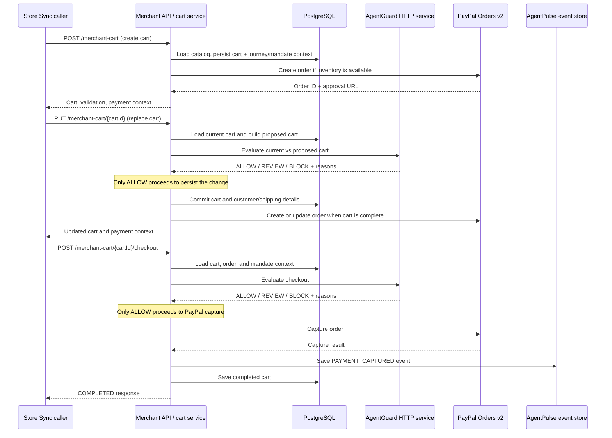

# Merchant and AgentGuard: Current Flow and Tools

> Working architecture note for the Mandate Lens project. This document describes the implementation currently in this repository and leaves room to add other components in later sections.

## 1. Purpose and scope

This note explains how the merchant cart and checkout flow works with AgentGuard, which tools and services participate, what data each part owns, and where the current implementation has gaps. It covers the Store Sync simulator path in the Spring Boot backend. It does not describe a production Store Sync deployment or a verified AP2 authorization flow.

## 2. Components and ownership

| Component | Responsibility | Current implementation |
|---|---|---|
| Store Sync caller | Sends cart create, replace, read, and checkout requests to the merchant | Local simulator-compatible API at `/merchant-cart`, enabled by the `storesync-simulator` Spring profile. |
| Merchant catalog and cart | Owns product data, cart contents, prices, availability, and cart state | Java services and PostgreSQL persistence in `merchant.catalog` and `merchant.cart`. |
| Merchant Store Sync adapter | Converts Store Sync-shaped requests to merchant operations and PayPal Orders calls | `StoreSyncCartController`, `StoreSyncCartService`, and `PayPalOrdersClient`. |
| Mandate data | Supplies the journey and mandate IDs and the constraints used by the guard | `MandateService` saves a clearly simulated AP2 mandate to the PostgreSQL `trust` schema at startup. |
| AgentGuard | Evaluates proposed cart changes and checkout against the mandate; returns `ALLOW`, `REVIEW`, or `BLOCK` with reasons | `AgentGuardClient` abstraction backed by `HttpAgentGuardClient`, which calls a loopback AgentGuard service. The AgentGuard service itself is not included in this repository. |
| AgentPulse | Stores and displays journey events and outcomes | Event API and PostgreSQL-backed `EventStore` are in the backend. The Store Sync flow currently records a `PAYMENT_CAPTURED` event after successful capture. |
| PayPal Orders | Creates, updates, and captures the payment order | `PayPalOrdersClient` calls PayPal Orders v2 using OAuth client credentials. Sandbox is the default base URL. |
| Demo shop UI | Displays the product catalog and shopping cart | React 19 and Vite. The current Store Sync simulator API is a separate backend integration path; the UI should not be assumed to drive that simulator flow. |

## 3. Flow at a glance

## 4. Merchant flow step by step

### 4.1 Create a cart

1. The caller sends `POST /merchant-cart` with item variant IDs, quantities, and optional customer/shipping details.
2. The merchant resolves the configured demo journey to an active mandate. The mandate is seeded locally and is marked `SIMULATED_AP2`.
3. The merchant creates the cart from its catalog, stores the cart details and its journey-to-mandate context, and checks availability.
4. If the cart is complete, the backend creates a PayPal Orders v2 order and returns the cart with the PayPal order ID and approval URL. If items are unavailable, it returns an `INCOMPLETE` cart without creating the order.

**Current behavior:** cart creation does not call AgentGuard. Guard evaluation happens on cart replacement and checkout. This is a meaningful integration boundary to revisit if initial cart creation must also be authorized.

### 4.2 Replace or update a cart

1. The caller sends `PUT /merchant-cart/{cartId}` with the full replacement cart.
2. The merchant loads the current cart and builds the proposed cart without committing it.
3. The merchant maps cart facts into an AgentGuard request: journey ID, mandate ID, action `UPDATE_CART`, current and proposed items, totals, currency, and shipping country.
4. The merchant requires a valid response with a decision ID. Only `ALLOW` proceeds. `REVIEW` and `BLOCK` both stop the operation in this adapter and return a conflict response with the guard reasons.
5. After `ALLOW`, the merchant commits the new cart and customer/shipping details. If the cart is complete, it creates or updates the linked PayPal order.

This ordering ensures a denied change does not become merchant cart state or a PayPal order update.

### 4.3 Read a cart

`GET /merchant-cart/{cartId}` returns the stored cart, validation status, and payment context. It does not call AgentGuard.

### 4.4 Checkout

1. The caller sends `POST /merchant-cart/{cartId}/checkout` with a PayPal payment method and order token.
2. The merchant verifies that the cart is complete, the payment method is PayPal, and the supplied order token matches the order it created.
3. The merchant sends the current cart, journey ID, mandate ID, and shipping country to AgentGuard for checkout evaluation.
4. Only `ALLOW` proceeds to PayPal capture. A denied decision or an unavailable/invalid guard response prevents capture.
5. On successful capture, the merchant saves a `PAYMENT_CAPTURED` event in AgentPulse's PostgreSQL event store and marks the cart completed.

## 5. AgentGuard connection and contract

The backend defines a replaceable `AgentGuardClient` interface with three operations:

- Register a mandate: `POST /api/guard/mandates`
- Evaluate a cart change: `POST /api/guard/evaluate/cart`
- Evaluate checkout: `POST /api/guard/evaluate/checkout`

The Store Sync adapter currently uses the two evaluation operations. Mandate registration exists in the client and request/response models, but the current Store Sync flow does not call it; the local `MandateService` seeds the demo mandate directly in PostgreSQL.

For a cart change, the payload contains the journey and mandate IDs, action, current cart, and proposed cart. For checkout, it contains the journey and mandate IDs and the current cart. Each cart includes its ID, items (variant/product ID, category, quantity, unit price), total, currency, and shipping country. A decision response contains a decision ID, a decision (`ALLOW`, `REVIEW`, or `BLOCK`), and reason codes/messages.

`HttpAgentGuardClient` sends JSON over HTTP using Spring's `RestClient`. It is deliberately restricted to loopback hosts (`localhost`, `127.0.0.1`, or `::1`) until AgentGuard authentication is defined. If AgentGuard is unconfigured, unreachable, returns an empty/invalid response, or returns a non-`ALLOW` decision, guarded operations fail closed.

The request/response examples in [Agentguard_contract.md](Agentguard_contract.md) are the working contract proposal. The AgentGuard service implementation and authentication setup are outside this repository.

## 6. Tools and technology in use

| Tool / technology | Used for |
|---|---|
| Java 17 and Spring Boot | Merchant API, service wiring, validation, and HTTP clients. |
| Maven Wrapper | Reproducible backend build and run commands. |
| PostgreSQL | Merchant catalog/cart/order-adapter state plus mandate and journey-event records. |
| Flyway | Database schema migrations. |
| Spring JDBC (`JdbcTemplate`) | Persistence in the current backend. |
| Spring `RestClient` | HTTP requests to AgentGuard and PayPal. |
| PayPal Orders v2 API | Create, patch, and capture checkout orders; Sandbox endpoint is the configured default. |
| React 19 and Vite | Demo storefront frontend. |
| JSON over HTTP | Store Sync-shaped merchant requests and the AgentGuard/PayPal integrations. |

## 7. Current boundaries and caveats

- The `storesync-simulator` profile exposes `/merchant-cart`. The controller has no PayPal JWT verifier and is documented in code for local development only; do not expose it publicly as-is.
- The current mandate is simulated startup data, not a live AP2 authorization proof. The configured demo journey ID defaults to `demo-shoes-001`.
- The `agentguard.enabled` setting defaults to `true`. A dedicated local Sandbox test profile can disable the guard call; that bypass is for testing only.
- AgentGuard calls are loopback-only and have no confirmed authentication contract yet.
- `REVIEW` is treated as a denial by the current merchant adapter. There is no human review workflow in this path.
- AgentPulse currently receives a payment-captured event from this checkout path. The cart creation, cart updates, and AgentGuard decisions are not all emitted as journey events by this service yet.
- PayPal capture success is recorded as an event after the external capture returns. Reliable recovery for a crash between PayPal capture and event persistence is not implemented here.
- The React storefront is a separate demo surface; do not infer that its cart invokes the Store Sync simulator endpoints.

## 8. Main code references

- Merchant Store Sync routes: `backend/src/main/java/com/emeralds/mandatelens/merchant/integration/storesync/controller/StoreSyncCartController.java`
- Merchant orchestration: `backend/src/main/java/com/emeralds/mandatelens/merchant/integration/storesync/service/StoreSyncCartService.java`
- Guard request mapping and decision enforcement: `backend/src/main/java/com/emeralds/mandatelens/merchant/integration/storesync/service/StoreSyncGuardService.java`
- Guard HTTP adapter: `backend/src/main/java/com/emeralds/mandatelens/agentguard/client/HttpAgentGuardClient.java`
- Guard contract models: `backend/src/main/java/com/emeralds/mandatelens/agentguard/model/`
- Demo mandate seed and persistence: `backend/src/main/java/com/emeralds/mandatelens/mandate/service/MandateService.java`
- PayPal client: `backend/src/main/java/com/emeralds/mandatelens/merchant/integration/storesync/service/PayPalOrdersClient.java`
- AgentPulse event persistence: `backend/src/main/java/com/emeralds/mandatelens/agentpulse/event/EventStore.java`
- Working AgentGuard contract: [Agentguard_contract.md](Agentguard_contract.md)

## 9. Add other components here

Use this repeatable outline when documenting another component:

1. **Purpose and owner** — what it does and which component/team owns it.
2. **Inputs and outputs** — requests, events, decisions, and identifiers exchanged.
3. **Flow** — numbered steps plus the upstream and downstream components.
4. **Tools** — libraries, services, APIs, databases, and runtime configuration.
5. **Data ownership** — authoritative source and what is persisted locally.
6. **Current status** — implemented, simulated, planned, or awaiting a contract.
7. **Failure behavior and open questions** — what happens when it is unavailable and what needs agreement.
